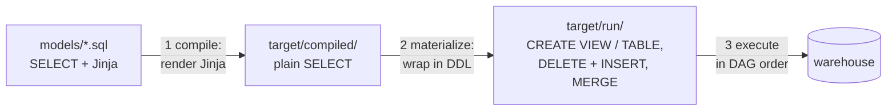
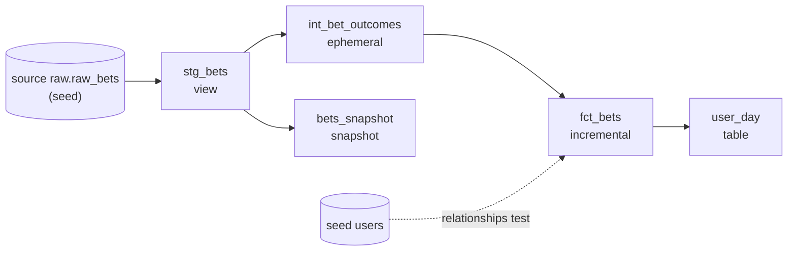

# dbt and Jinja: from Zero to Reading Real Projects

dbt (data build tool) turns a folder of `SELECT` statements into tables and views in a warehouse, in the right order, and tests them. The SQL files are templates written in Jinja, a small template language from Python, so a dbt project is really two languages mixed together. This guide teaches both, one idea at a time, until you can open any model or macro in a real project and say exactly what SQL it produces and when it runs.

One small project, `toy_bets/`, runs through every chapter: a few players place bets, one bet settles a day late, and we build a per-bet fact table and per-player daily statistics. Every output shown in this guide was produced by running that project or the Jinja examples, and the tests in this folder check them, so the guide and the code cannot drift apart.

**Files in this folder**

| File | Contents |
| --- | --- |
| `README.md` | This guide |
| `toy_bets/` | A complete dbt project (dbt 1.7 + DuckDB, a database in a single local file, no server) |
| `render.py` | Renders dbt-style Jinja without dbt or a database (Chapter 9) |
| `test_jinja_basics.py` | Checks the Jinja examples of Chapters 2, 3, 6 and 10 |
| `test_toy_bets.py` | Builds `toy_bets` with dbt and checks the lab of Section 1.6, the tables of Chapters 5–8, the state selection of Chapter 11, and `render.py` against `dbt compile` (skipped when dbt is not installed) |
| `test_exercises.py` | Applies the solution of each exercise (Chapter 13) to a copy of `toy_bets` and checks the answers given there |
| `requirements.txt` | dbt-core and dbt-duckdb, pinned to 1.7 |

The guide is pinned to dbt 1.7, which is past its end of support but still common in production setups; Chapter 12 lists what changed after it. The toy project also builds unchanged on dbt 1.10.

Setup, from the repo root:

```bash
python -m venv .venv && source .venv/bin/activate
pip install -r requirements.txt                          # jinja2, pytest (enough for test_jinja_basics.py)
pip install -r data-engineering/dbt/requirements.txt     # dbt 1.7 with the DuckDB adapter
pytest data-engineering/dbt                              # about 20 seconds
```

**How to use this guide.** Do the lab in Section 1.6 first: it takes about 30 minutes and shows every part of dbt working once. Then read Chapters 2–8 in order, running each example as you go. Chapters 9–12 are for when you meet a real project; Chapter 13 has exercises with solutions.

## Contents

1. [What dbt does: the mental model](#chapter-1-what-dbt-does-the-mental-model)
2. [Jinja from zero](#chapter-2-jinja-from-zero)
3. [What dbt adds to Jinja](#chapter-3-what-dbt-adds-to-jinja)
4. [Models, materializations and configs](#chapter-4-models-materializations-and-configs)
5. [Incremental models in depth](#chapter-5-incremental-models-in-depth)
6. [Macros: five patterns you will meet](#chapter-6-macros-five-patterns-you-will-meet)
7. [Tests and documentation](#chapter-7-tests-and-documentation)
8. [Sources, seeds, snapshots, hooks and packages](#chapter-8-sources-seeds-snapshots-hooks-and-packages)
9. [How to read an unfamiliar dbt project](#chapter-9-how-to-read-an-unfamiliar-dbt-project)
10. [Gotchas](#chapter-10-gotchas)
11. [dbt in production](#chapter-11-dbt-in-production)
12. [After dbt 1.7: what newer versions add](#chapter-12-after-dbt-17-what-newer-versions-add)
13. [Exercises, with solutions](#chapter-13-exercises-with-solutions)
14. [Further reading](#chapter-14-further-reading)

## Chapter 1. What dbt does: the mental model

### 1.1 One sentence

You write one `SELECT` per table you want. dbt fills in the Jinja, wraps each `SELECT` in the `CREATE ...` statement its configuration asks for, and runs them in dependency order.



DDL (data definition language) means the statements that create or change tables, such as `CREATE TABLE`. DAG (directed acyclic graph) means the dependency graph between models: an arrow from A to B says "B selects from A", and there are no cycles.

Two folders under `target/` are worth knowing by heart:

| Folder | What is in it | Use it to |
| --- | --- | --- |
| `target/compiled/<project>/models/...` | The `SELECT` after Jinja, before dbt wraps it | Read what a model really queries |
| `target/run/<project>/models/...` | The full statement dbt sent: `CREATE TABLE AS`, `DELETE`/`INSERT`, `MERGE` | See how a materialization writes the data |

### 1.2 The toy project

```
toy_bets/
├── dbt_project.yml          project name, folder defaults, vars
├── profiles.yml             how to connect (usually lives in ~/.dbt/)
├── seeds/                   CSV files that dbt loads as tables
│   ├── raw_bets.csv
│   └── users.csv
├── models/
│   ├── staging/
│   │   ├── _sources.yml     declares raw tables dbt did not build
│   │   ├── stg_bets.sql     view: latest version of each bet
│   │   └── int_bet_outcomes.sql   ephemeral: profit, rtp, is_win
│   └── marts/
│       ├── _marts.yml       descriptions and tests
│       ├── fct_bets.sql     incremental table, one row per bet
│       └── user_day.sql     table, stats per user and day
├── snapshots/
│   └── bets_snapshot.sql    history of every bet (Section 8.3)
├── macros/                  reusable Jinja functions
└── tests/                   singular tests + custom generic tests
```

Its DAG, as dbt infers it from `ref()` and `source()` calls (Chapter 3):



The raw data, `seeds/raw_bets.csv`. Bet 4 appears twice: it was `pending` when first loaded on Jan 1 and `settled` with a payout of 40 when loaded again on Jan 2.

| bet_id | user_id | bet_amount | payout | status | created_at | loaded_at |
| --- | --- | --- | --- | --- | --- | --- |
| 1 | 101 | 10 | 0 | settled | 01-01 09:00 | 01-01 23:00 |
| 2 | 101 | 10 | 25 | settled | 01-01 09:01 | 01-01 23:00 |
| 3 | 101 | 20 | 0 | settled | 01-01 09:03 | 01-01 23:00 |
| 4 | 102 | 5 | 0 | pending | 01-01 10:00 | 01-01 23:00 |
| 5 | 102 | 5 | 15 | settled | 01-01 10:02 | 01-01 23:00 |
| 4 | 102 | 5 | 40 | settled | 01-01 10:00 | 01-02 23:00 |
| 6 | 101 | 10 | 10 | settled | 01-02 08:00 | 01-02 23:00 |
| 7 | 103 | 50 | 0 | settled | 01-02 12:00 | 01-02 23:00 |
| 8 | 103 | 50 | 120 | settled | 01-02 12:05 | 01-02 23:00 |

### 1.3 Connecting: profiles and targets

`dbt_project.yml` names a profile (`profile: toy_bets`); `profiles.yml` says how to connect for that profile. A profile has one or more **targets** (for example `dev` and `prod`), each a set of connection settings; `target:` picks the default and `--target prod` picks another.

```yaml
toy_bets:
  target: dev
  outputs:
    dev:
      type: duckdb                 # the adapter: which database plugin dbt loads
      path: "{{ env_var('TOY_BETS_DB', 'toy_bets.duckdb') }}"
      threads: 1                   # how many models dbt builds in parallel
```

For Redshift the same block has `type: redshift`, `host`, `user`, `password`, `dbname`, `schema`. Note the Jinja inside the YAML: `profiles.yml` and `dbt_project.yml` are rendered too, which is how passwords stay out of files (`env_var`).

dbt looks for `profiles.yml` in the current folder first, then in `~/.dbt/`; `--profiles-dir` overrides both.

### 1.4 Commands

| Command | What it does |
| --- | --- |
| `dbt debug` | Checks `profiles.yml` and the connection |
| `dbt parse` | Reads every file, builds the DAG; no SQL is run |
| `dbt compile -s user_day` | Renders Jinja into `target/compiled/`; runs no model (but does run `run_query` calls, Section 3.6) |
| `dbt seed` | Loads `seeds/*.csv` into tables |
| `dbt run -s fct_bets` | Builds the selected models |
| `dbt snapshot` | Runs the snapshots (Section 8.3) |
| `dbt show -s fct_bets` / `dbt show --inline "SELECT ..."` | Runs a model's `SELECT` (or any query) and prints the first rows; writes nothing |
| `dbt test -s fct_bets` | Runs the selected tests |
| `dbt build` | seed + run + snapshot + test, in DAG order; a failing test skips everything downstream of it |
| `dbt run-operation row_count --args '{model_name: fct_bets}'` | Runs one macro by hand (Section 6.5) |
| `dbt ls -s +user_day` | Lists what a selection would pick, without running it |
| `dbt docs generate && dbt docs serve` | Builds and opens a website of models, columns and the DAG |

Common flags: `-s` / `--select` (Section 4.5), `--exclude`, `--vars '{as_of: "2026-01-01"}'`, `--full-refresh` (Chapter 5), `--target prod`.

Section 1.6 runs all of them.

### 1.5 Two phases: parse, then execute

This one idea explains a lot of strange-looking code. dbt renders every file **twice**:

1. **Parse** (every command, every file). dbt renders the Jinja only to discover `ref()`, `source()` and `config()` calls, which build the DAG. Nothing has been built yet and no query may run. During this phase the variable `execute` is `False`.
2. **Execute** (only the selected models, at `run`, `compile`, `build`, `test`). dbt renders the model again, for real, with `execute = True`, then sends the SQL.

So code that needs the database while rendering (`run_query`, Section 3.6) must be guarded with ``, and code that reads a var only passed at run time can return a placeholder during parsing. Chapter 6 shows both.

### 1.6 Lab: a first session, step by step

Everything below runs on your laptop: DuckDB keeps the whole warehouse in one file, `toy_bets.duckdb`. Activate the virtual environment from the setup above, then:

```bash
cd data-engineering/dbt/toy_bets
export DBT_SEND_ANONYMOUS_USAGE_STATS=false      # optional: no usage statistics sent to dbt Labs
```

`profiles.yml` sits in this folder, and dbt looks in the current folder first, so no `~/.dbt/` set-up is needed. To start over at any point, delete the database: `rm toy_bets.duckdb`. `target/`, `logs/` and the database are git-ignored.

**Step 1. Check the connection.**

```bash
dbt debug
```

The last lines should be `Connection test: [OK connection ok]` and `All checks passed!`. If not, the error names the file or setting at fault.

**Step 2. Build everything, and watch it fail.**

```bash
dbt build
```

```
1 of 14 ERROR creating sql view model main.stg_bets ...... [ERROR]
2 of 14 OK loaded seed file main.raw_bets ................ [INSERT 9]
3 of 14 OK loaded seed file main.users ................... [INSERT 3]
4 of 14 SKIP relation snapshots.bets_snapshot ............ [SKIP]
5 of 14 SKIP relation main.fct_bets ...................... [SKIP]
...
  Catalog Error: Table with name raw_bets does not exist!
```

Read the order: dbt built `stg_bets` **before** loading the seed `raw_bets`. `stg_bets` reads the table with `source('raw', 'raw_bets')`, and a source means "a table loaded by something outside dbt", so dbt draws no edge from the seed to it. In a real project the outside loader (an ingestion job) fills the raw tables before dbt runs; here `dbt seed` plays that loader. Everything downstream of the error is `SKIP`ped: dbt never builds on top of a failed model. Lesson: `ref()` creates a DAG edge, `source()` does not.

**Step 3. Load the raw data, then build the world as of Jan 1.**

```bash
dbt seed
dbt run --vars '{as_of: "2026-01-01 23:59:59"}'
```

`dbt run` prints one line per model, in DAG order: `stg_bets` (view), `fct_bets` (incremental), `user_day` (table). `int_bet_outcomes` is missing from the list because it is ephemeral (Section 4.1). Look at the result without leaving dbt:

```bash
dbt show -s fct_bets
dbt show --inline "SELECT bet_id, payout, status FROM {{ ref('fct_bets') }} WHERE bet_id = 4"
```

Bet 4 is `pending` with payout 0: the Jan 2 row of the CSV has not "arrived" yet.

**Step 4. Read what dbt sent to the database.** Open these two files side by side:

- `target/compiled/toy_bets/models/marts/fct_bets.sql`: the `SELECT` after Jinja. The `ref()` became `__dbt__cte__int_bet_outcomes`, the `` block is gone.
- `target/run/toy_bets/models/marts/fct_bets.sql`: the same `SELECT` wrapped in `create table ... as (...)`.

**Step 5. Snapshot the bets.**

```bash
dbt snapshot
```

This creates `snapshots.bets_snapshot` with one row per bet, `dbt_valid_to` empty (Section 8.3).

**Step 6. Move to Jan 2: the incremental run.**

```bash
dbt run
dbt show --inline "SELECT bet_id, payout, status, loaded_at FROM {{ ref('fct_bets') }} ORDER BY bet_id"
```

Without `--vars`, `as_of` is the default from `dbt_project.yml`, Jan 2. Bet 4 is now `settled` with payout 40, and bets 6–8 have arrived. Open `target/run/toy_bets/models/marts/fct_bets.sql` again: it is now a `delete from ... insert into ...` pair, not a `create table`, because the table existed (Chapter 5 walks through it).

**Step 7. Snapshot again, and see history.**

```bash
dbt snapshot
dbt show --inline "SELECT bet_id, payout, status, dbt_valid_from, dbt_valid_to FROM {{ ref('bets_snapshot') }} WHERE bet_id = 4"
```

```
| bet_id | payout | status  |      dbt_valid_from |        dbt_valid_to |
| ------ | ------ | ------- | ------------------- | ------------------- |
|      4 |      0 | pending | 2026-01-01 23:00:00 | 2026-01-02 23:00:00 |
|      4 |     40 | settled | 2026-01-02 23:00:00 |                     |
```

`fct_bets` keeps only the latest version of bet 4; the snapshot keeps both.

**Step 8. Test, then break a test on purpose.**

```bash
dbt test                     # Done. PASS=8 WARN=0 ERROR=0
```

Now edit `tests/assert_payout_at_most_10x.sql` and change `10 * bet_amount` to `2 * bet_amount`. Run:

```bash
dbt build
```

```
7 of 14 FAIL 4 assert_payout_at_most_10x ........ [FAIL 4]
13 of 14 SKIP relation main.user_day .............. [SKIP]
14 of 14 SKIP test unique_columns_user_day_... .... [SKIP]
Done. PASS=11 WARN=0 ERROR=1 SKIP=2 TOTAL=14
```

`FAIL 4` means the test query returned 4 rows (bets 2, 4, 5 and 8 paid more than twice the stake). The test is attached to `fct_bets`, so `dbt build` refuses to build `user_day` from it. This is the reason to use `build` in schedules rather than `run` then `test`: bad data stops where it is found. Change the `2` back to `10`.

**Step 9. Select parts of the DAG.**

```bash
dbt ls -s +user_day            # user_day and everything it depends on
dbt ls -s stg_bets+            # stg_bets and everything that depends on it
dbt run -s user_day            # rebuild one model only
```

**Step 10. Browse the documentation site.**

```bash
dbt docs generate
dbt docs serve                 # opens http://localhost:8080; Ctrl-C to stop
```

Click `fct_bets`: its description and column tests come from `_marts.yml`, its compiled SQL from the same files you read in Step 4, and the button at the bottom right draws the DAG.

You have now used every main command. The rest of the guide explains what each piece does and why.

## Chapter 2. Jinja from zero

Jinja is a template language: ordinary text with holes in it. dbt hands Jinja a `.sql` file; whatever Jinja prints is the SQL. You can run every example in this chapter with `render.py`:

```python
from render import render
render("{{ 1 + 2 }}")          # '3'
```

### 2.1 Three kinds of brackets

| Syntax | Name | Meaning |
| --- | --- | --- |
| `{{ ... }}` | expression | Compute a value and **print** it |
| `` | statement | Do something (`if`, `for`, `set`, `macro`); prints nothing by itself |
| `{# ... #}` | comment | Ignored; does not reach the SQL (a `-- SQL comment` does) |

Everything outside the brackets is copied to the output unchanged.

```jinja
{{ 1 + 2 }} {{ 'bet' ~ '_' ~ 3 }} {{ [1, 2, 3] | length }} {{ 'abc' | upper }}
```
renders as `3 bet_3 3 ABC`.

`~` joins any values into a string (it converts numbers for you). `+` also joins strings, but `'bet_' + 3` is an error (`can only concatenate str (not "int") to str`), which is why dbt code uses `~` almost everywhere.

`a{# not in the output #}b` renders as `ab`.

### 2.2 Values: the same types as Python

| Type | Literal | Notes |
| --- | --- | --- |
| string | `'payout'` or `"payout"` | |
| number | `3`, `0.25` | |
| boolean | `true` / `false` (also `True` / `False`) | |
| none | `none` (also `None`) | like Python `None`; in SQL it prints as `None`, not `NULL` |
| list | `['a', 'b']` | |
| tuple | `('rtp', 'payout / bet_amount')` | a fixed pair; used for (alias, expression) lists |
| dict | `{'label': 'A', 'values': [1, 3]}` | |

Read an item with `rule['label']`. Jinja also accepts `rule.label`, but beware: for a dict, `rule.values` is the dict's **method** `values()`, not the key `'values'` (Chapter 10). Write `rule['values']`. Most methods of Python strings, lists and dicts also work: `rule.get('op', 'in')`, `name.startswith('stg_')`, `cols.append(x)`.

### 2.3 Variables: `set`

```jinja


```

There is also a **block** form that captures rendered text into a variable; dbt code uses it for queries it is about to run:

```jinja

SELECT COUNT(*)
FROM bets
[{{ q | trim }}]
```
renders as:
```
[SELECT COUNT(*)
FROM bets]
```

### 2.4 `if`

```jinja
bigmediumsmall
```
renders as `medium`. Comparisons and logic are Python's: `==`, `!=`, `<`, `and`, `or`, `not`, `in`.

**Tests** (checks written with `is`):

```jinja
{{ none is none }} {{ x is defined }} {{ 4 is even }} {{ 'a' in ['a', 'b'] }}
```
renders as `True False True True` (`x` was never set). Others: `is string`, `is number`, `is mapping` (a dict), `is iterable`.

### 2.5 `for` loops and the `loop` variable

```jinja
{{ loop.index0 }}:{{ c }}{{ ', ' if not loop.last }}
```
renders as `0:a, 1:b, 2:c`.

Inside a loop, `loop` tells you where you are:

| Attribute | Value |
| --- | --- |
| `loop.index0` / `loop.index` | position, from 0 / from 1 |
| `loop.first` / `loop.last` | true on the first / last item |
| `loop.length` | number of items |

`{{ ',' if not loop.last }}` is the most common line in dbt code: a comma after every item but the last, so the generated column list is valid SQL. `X if condition` without `else` prints nothing when the condition is false; with `else` it is Python's conditional expression: `{{ 'a' if ok else 'b' }}`.

Loop over a dict with `for key, value in d.items()`, and over a list of pairs by unpacking: `for alias, expr in metrics`.

A loop can **filter** its items; `loop.index0` then counts only the kept ones:

```jinja
{{ loop.index0 }}:{{ c }} 
```
renders as `0:a 1:c `.

### 2.6 Whitespace control: the `-` in ``

Statements print nothing, but the newlines around them stay. Without control:

```jinja
SELECT

    {{ c }},

1
```
renders with blank lines, because each `` line leaves its newline behind:
```
SELECT

    a,

    b,

1
```

A `-` on the inside of a bracket removes **all whitespace, including newlines, on that side**: `` eats whitespace after it. The same works for `{{-`, `-}}`, `{#-`, `-#}`.

```jinja
SELECT

    {{ c }},

1
```
renders as:
```
SELECT
    a,
    b,
1
```

How to read it: `{%- for` glues the loop to the end of `SELECT`; each item then starts with the template's own newline and indent; `{%- endfor` removes the newline after `{{ c }},` so items do not double-space. Whitespace control never changes what the SQL **means**, only how the compiled file looks. When reading code, you can mentally delete every `-`.

### 2.7 Filters: `value | filter`

A filter transforms a value; filters chain from left to right.

```jinja
{{ [3, 1, 2] | sort | list }} {{ ['1', '2'] | map('int') | sum }} {{ 'a_b' | replace('_', '-') }}
```
renders as `[1, 2, 3] 3 a-b`.

The ones you will see in dbt code:

| Filter | Example | Result |
| --- | --- | --- |
| `join(sep)` | `['a', 'b'] \| join(', ')` | `a, b` |
| `length` | `[1, 2] \| length` | `2` |
| `upper`, `lower`, `trim`, `replace(a, b)` | `' x ' \| trim` | `x` |
| `int`, `float`, `string` | `'7' \| int` | `7` |
| `default(v)` | `undefined_name \| default('n/a')` | `n/a` (only for **undefined**; `none \| default('n/a')` stays `None` unless you write `default('n/a', true)`) |
| `map('f')` / `map(attribute='k')` | `rules \| map(attribute='label') \| list` | apply a filter / pick a key from every item |
| `select('test')`, `reject('test')` | `xs \| reject('none') \| list` | keep / drop items passing a test |
| `selectattr(k, 'test', v)`, `rejectattr(...)` | `metrics \| rejectattr(0, 'equalto', 'x') \| list` | keep / drop items whose attribute or index `k` passes the test |
| `list` | `xs \| map('int') \| list` | turn a lazy result into a real list (needed before printing or indexing) |
| `first`, `last`, `unique`, `sort`, `sum`, `min`, `max` | | as named |

`[('x', 1), ('y', 2)] | rejectattr(0, 'equalto', 'x') | list` renders as `[('y', 2)]`: index 0 of each tuple is compared with `'x'`.

### 2.8 Scope: why `set` inside a loop "does nothing"

```jinja
{{ total }}
```
renders as `0`. A `set` inside a loop creates a new variable that lives only for that loop step. Two ways around it:

```jinja
{{ ns.total }}
```
renders as `6`; a `namespace` is an object whose attributes survive the loop. Or **mutate** a list or dict created outside the loop, which is the usual dbt way:

```jinja
{{ cols | join(', ') }}
```
renders as `bet_avg, payout_avg`. `do` (a Jinja extension dbt turns on) runs an expression and throws away its result; `{{ cols.append(x) }}` would print `None` into the SQL.

### 2.9 Macros: functions that print text

```jinja

PERCENTILE_CONT({{ q }}) WITHIN GROUP (ORDER BY {{ col }})

{{ pct('payout') }} | {{ pct('payout', q=0.25) }}
```
renders as `PERCENTILE_CONT(0.5) WITHIN GROUP (ORDER BY payout) | PERCENTILE_CONT(0.25) WITHIN GROUP (ORDER BY payout)`.

A macro has positional arguments, defaults (`q=0.5`) and keyword calls (`q=0.25`), like a Python function. The important difference: **a macro's result is the text it rendered**, always a string. With `2`, `{{ v ~ v }}` renders as `22`, not `4`, and `v is string` is `True`. To hand back a list or a number you need dbt's `return()` (Section 3.4).

Macros are also how you read most of a dbt project: every `{{ something(...) }}` that is not a built-in (Chapter 3) is a macro defined in some `macros/*.sql` file, in this project or in a package.

## Chapter 3. What dbt adds to Jinja

dbt puts extra variables and functions into Jinja's context (the set of names a template can use). These are the ones you will meet, roughly from most to least common.

| Name | What it is | Example → compiled |
| --- | --- | --- |
| `ref('model')` | The table/view of another model; also records a DAG edge | `{{ ref('stg_bets') }}` → `"toy"."main"."stg_bets"` |
| `source('src', 'table')` | A table dbt did not build, declared in a `sources:` YAML | `{{ source('raw', 'raw_bets') }}` → `"toy"."main"."raw_bets"` |
| `this` | The table of the model being built (used in incremental filters) | `{{ this }}` → `"toy"."main"."fct_bets"` |
| `config(...)` | Sets the model's materialization and options (Chapter 4) | prints nothing |
| `is_incremental()` | True when an incremental model adds to an existing table (Chapter 5) | |
| `var('name', default)` | A project variable: `--vars` on the command line, else `vars:` in `dbt_project.yml`, else the default | `'{{ var("as_of") }}'` → `'2026-01-02 23:59:59'` |
| `env_var('NAME', default)` | An environment variable | used for secrets in `profiles.yml` |
| `target` | The active target: `target.name`, `target.schema`, `target.type` | `` |
| `return(value)` | Ends a macro and hands back a Python value | Section 3.4 |
| `execute` | False during parsing, True when running (Section 1.5) | |
| `run_query(sql)` | Runs SQL **while rendering** and returns the result table | Section 3.6 |
| `log(msg, info=True)` | Prints to the console / log | |
| `exceptions.raise_compiler_error(msg)` | Stops the run with an error message | Section 6.4 |
| `modules.datetime`, `modules.re`, ... | A few Python modules | `modules.datetime.date.today()` |
| `fromyaml`, `toyaml`, `fromjson`, `tojson` | Convert between text and values | |
| `adapter`, `flags`, `graph`, `invocation_id` | Advanced: adapter methods, CLI flags (`flags.FULL_REFRESH`), the whole DAG | |

### 3.1 `ref` and `source`: never hard-code a table name

`ref('stg_bets')` does two jobs: it prints the full name of the table in the current target (so the same code writes to a dev schema or a prod schema) and it tells dbt that this model depends on `stg_bets`, so `stg_bets` is built first. A hard-coded `FROM main.stg_bets` would work once but break the DAG order and the dev/prod switch.

`source()` is the same for tables loaded by something else; `models/staging/_sources.yml` declares them:

```yaml
sources:
  - name: raw                 # the name used in source('raw', ...)
    schema: main              # where the tables really are
    tables:
      - name: raw_bets
```

### 3.2 `config()`

```jinja
{{ config(materialized='incremental', unique_key='bet_id') }}
```

prints nothing; dbt records the settings during parsing. Chapter 4 lists them.

### 3.3 `var()`

`stg_bets` keeps only rows loaded by a simulated "now":

```sql
WHERE loaded_at <= '{{ var("as_of") }}'
```

With the default in `dbt_project.yml` (`as_of: '2026-01-02 23:59:59'`) this compiles to `WHERE loaded_at <= '2026-01-02 23:59:59'`; `dbt run --vars '{as_of: "2026-01-01 23:59:59"}'` overrides it. A var can hold any YAML value, including a list of dicts (`ab_rules`, Section 6.4). Without a default, a missing var is a compile error.

### 3.4 `return()`: macros that hand back values

```jinja

    {{ return([
        ('bet_amount', 'bet_amount'),
        ('payout', 'payout'),
        ('profit', 'profit'),
        ('rtp', 'rtp'),
        ('delta_t_seconds', 'delta_t_seconds'),
    ]) }}

```

`` now gives a real list of 5 tuples, not text. Projects use such macros as **configuration**: one place that lists metrics, games, thresholds, read by several models. A macro can call another config macro and transform the result:

```jinja

    {{ return(bet_metrics() | rejectattr(0, 'equalto', 'delta_t_seconds') | list) }}

```

### 3.5 `this` and `is_incremental()`

Both belong to incremental models; Chapter 5 is about them.

### 3.6 `run_query()` and `execute`

`run_query` runs SQL while the template is being rendered, so the result can shape the SQL itself. `macros/row_count.sql`:

```jinja

    
        SELECT COUNT(*) FROM {{ ref(model_name) }}
    
    
        
        {{ log(model_name ~ ' has ' ~ n ~ ' rows', info=True) }}
    

```

`dbt run-operation row_count --args '{model_name: fct_bets}'` prints `fct_bets has 8 rows`.

`run_query` returns an agate table (a small table object from the `agate` Python library): `.columns[0].values()[0]` is "first column, first row"; `.rows` gives rows. The `` guard matters: during parsing (Section 1.5) there is no database, and the result would be `None`. Real projects use this for **watermarks** (the newest timestamp already loaded), Section 5.6.

### 3.7 `target` in Jinja vs `target` in SQL

`{{ target.name }}` is dbt's target. A plain-SQL alias such as `JOIN plan AS target ... target.op_code` is just SQL text that Jinja never touches. Only what is inside `{{ }}` or `` is Jinja.

## Chapter 4. Models, materializations and configs

### 4.1 A model is a `SELECT`

One `.sql` file under `models/` = one model = one table or view, named after the file. No `CREATE`, no `INSERT`: the **materialization** decides how the `SELECT` is written to the warehouse.

| Materialization | dbt writes | Rebuilt each run? | Use for |
| --- | --- | --- | --- |
| `view` | `CREATE VIEW AS SELECT ...` | yes (cheap: no data stored) | light cleanup over raw tables |
| `table` | `CREATE TABLE AS SELECT ...` (into a temp name, then swapped in) | yes, fully | small or medium results read often |
| `incremental` | first run: `CREATE TABLE AS`; later: only new or changed rows | no, only the new part | big, growing tables (Chapter 5) |
| `ephemeral` | nothing; pasted as a CTE into the models that `ref` it | n/a | small shared steps |

CTE (common table expression) is a named subquery: the `WITH name AS (...)` blocks.

`int_bet_outcomes` is ephemeral. In the compiled `fct_bets` it appears as a CTE named `__dbt__cte__int_bet_outcomes`:

```sql
with __dbt__cte__int_bet_outcomes as (
SELECT
    *,
    payout - bet_amount AS profit,
    (payout) / NULLIF(bet_amount, 0) AS rtp,
    CASE WHEN payout > bet_amount THEN 1 ELSE 0 END AS is_win
FROM "toy"."main"."stg_bets"
) SELECT *
FROM __dbt__cte__int_bet_outcomes
```

### 4.2 Where a config can be set, and which one wins

From weakest to strongest:

1. `dbt_project.yml`, by folder; the `+` marks a config (not a sub-folder name):
   ```yaml
   models:
     toy_bets:
       staging:
         +materialized: view
       marts:
         +materialized: table
   ```
   A deeper folder beats a shallower one.
2. A `config:` block for the model in a properties YAML (`_marts.yml`).
3. `{{ config(...) }}` at the top of the model file. **This wins.**

So `fct_bets` is in `marts/` (default `table`) but its own `config(materialized='incremental')` makes it incremental.

### 4.3 Configs you will see

| Config | Meaning |
| --- | --- |
| `materialized` | Section 4.1 |
| `unique_key` | Column(s) that identify a row, for incremental updates (Chapter 5) |
| `incremental_strategy` | `append`, `delete+insert`, `merge`, `insert_overwrite` (Chapter 5) |
| `merge_update_columns` | With `merge`: the only columns updated on a match |
| `on_schema_change` | What an incremental model does when its columns change (Section 5.5) |
| `tags` | Labels for selection: `tags=['daily']` → `dbt run -s tag:daily` |
| `schema`, `alias` | Write to another schema / under another table name |
| `full_refresh` | `false` makes the model ignore `--full-refresh` (a safety switch for tables that cannot be rebuilt) |
| `enabled` | `false` removes the model from the project |
| `pre_hook`, `post_hook` | SQL to run before / after the model (Section 8.4) |
| Redshift: `sort`, `dist`, `sort_type` | Sort key and distribution key of the table (how Redshift orders rows on disk and spreads them over nodes) |

Unknown keys are passed through to the adapter, which is why each warehouse has its own configs.

### 4.4 Naming layers

Projects usually name models by layer: `stg_` (staging: rename, cast, deduplicate one source), `int_` (intermediate: shared steps), `fct_` (facts: one row per event, such as a bet), `dim_` (dimensions: one row per thing, such as a user), and marts or feature tables built for one consumer. It is a convention, not a rule dbt enforces.

### 4.5 Selecting what to run

| Selector | Picks |
| --- | --- |
| `-s fct_bets` | that model |
| `-s fct_bets+` | it and everything downstream |
| `-s +fct_bets` | it and everything upstream |
| `-s +fct_bets+` | both directions |
| `-s tag:daily` | models tagged `daily` |
| `-s path:models/marts` or `-s marts` | a folder |
| `-s fct_bets user_day` | either (a space means OR) |
| `-s "tag:daily,marts"` | both (a comma means AND) |
| `--exclude tag:no_full_refresh` | minus these |

`dbt ls -s <selector>` shows the result without running anything. Schedulers such as Airflow usually call `dbt run -s tag:<schedule>` or one model at a time.

## Chapter 5. Incremental models in depth

A `table` model recomputes everything each run. For a billion-row bet table that is too slow, so an **incremental** model computes only the new part and adds it to the table that already exists.

### 5.1 The pattern

`models/marts/fct_bets.sql`:

```jinja
{{
    config(
        materialized='incremental',
        unique_key='bet_id',
        incremental_strategy='delete+insert',
        on_schema_change='append_new_columns',
        tags=['daily']
    )
}}

SELECT *
FROM {{ ref('int_bet_outcomes') }}

-- only rows that arrived after the newest row already in this table
WHERE loaded_at > (SELECT MAX(loaded_at) FROM {{ this }})

```

`is_incremental()` is true only when **all** of these hold: the model is materialized `incremental`, its table already exists, and the run is not `--full-refresh`. So the same file yields two different queries:

| Run | `is_incremental()` | Compiled `SELECT` | dbt then |
| --- | --- | --- | --- |
| First run, or `--full-refresh` | false | everything | `CREATE TABLE fct_bets AS <select>` |
| Later runs | true | only `loaded_at > MAX(loaded_at)` of the table | writes the result into the table with the strategy |

### 5.2 Walking through two runs

**Run 1**, as of Jan 1 (`dbt run --vars '{as_of: "2026-01-01 23:59:59"}'`). The table does not exist, so the whole `SELECT` runs. `fct_bets`:

| bet_id | user_id | ab_group | bet_amount | payout | status | profit | rtp | loaded_at |
| --- | --- | --- | --- | --- | --- | --- | --- | --- |
| 1 | 101 | A | 10 | 0 | settled | -10 | 0.0 | 01-01 23:00 |
| 2 | 101 | A | 10 | 25 | settled | 15 | 2.5 | 01-01 23:00 |
| 3 | 101 | A | 20 | 0 | settled | -20 | 0.0 | 01-01 23:00 |
| 4 | 102 | B | 5 | 0 | **pending** | -5 | 0.0 | 01-01 23:00 |
| 5 | 102 | B | 5 | 15 | settled | 10 | 3.0 | 01-01 23:00 |

**Run 2**, as of Jan 2 (`dbt run`). Now `is_incremental()` is true, `MAX(loaded_at)` in the table is `01-01 23:00`, and the `SELECT` returns the four rows loaded on Jan 2: bets 4 (new version), 6, 7, 8. dbt writes them into a temporary table and runs (from `target/run/.../fct_bets.sql`, shortened):

```sql
delete from "toy"."main"."fct_bets"
where (bet_id) in (select (bet_id) from "fct_bets__dbt_tmp...");

insert into "toy"."main"."fct_bets" ("bet_id", "user_id", ...)
(select "bet_id", "user_id", ... from "fct_bets__dbt_tmp...");
```

The old version of bet 4 is deleted (its `bet_id` is in the new batch) and the new one inserted:

| bet_id | user_id | ab_group | bet_amount | payout | status | profit | rtp | loaded_at |
| --- | --- | --- | --- | --- | --- | --- | --- | --- |
| 1 | 101 | A | 10 | 0 | settled | -10 | 0.0 | 01-01 23:00 |
| 2 | 101 | A | 10 | 25 | settled | 15 | 2.5 | 01-01 23:00 |
| 3 | 101 | A | 20 | 0 | settled | -20 | 0.0 | 01-01 23:00 |
| 4 | 102 | B | 5 | **40** | **settled** | 35 | 8.0 | **01-02 23:00** |
| 5 | 102 | B | 5 | 15 | settled | 10 | 3.0 | 01-01 23:00 |
| 6 | 101 | A | 10 | 10 | settled | 0 | 1.0 | 01-02 23:00 |
| 7 | 103 | holdout | 50 | 0 | settled | -50 | 0.0 | 01-02 23:00 |
| 8 | 103 | holdout | 50 | 120 | settled | 70 | 2.4 | 01-02 23:00 |

This is the result a full rebuild gives too (`test_toy_bets.py` checks that): the goal of every incremental model is "same table as a full refresh, for less work".

Without `unique_key`, the strategy would only append, and bet 4 would appear twice.

### 5.3 Strategies

| Strategy | What it runs | Needs `unique_key` | Notes |
| --- | --- | --- | --- |
| `append` | `INSERT` the new rows | no | duplicates if a row comes back |
| `delete+insert` | `DELETE` rows whose key is in the batch, then `INSERT` the batch | yes | used here (DuckDB adapter 1.7 offers `append` and `delete+insert`) |
| `merge` | `MERGE`: update matching rows, insert the others | yes | Redshift, Snowflake, BigQuery, Databricks; `merge_update_columns=[...]` limits which columns an update changes |
| `insert_overwrite` | replace whole partitions | partitions | BigQuery, Spark |

The default strategy depends on the adapter, so well-written models set it explicitly. With `merge` and `merge_update_columns=['status', 'payout']`, a re-delivered bet would only refresh those two columns and keep the others as first written.

### 5.4 The lookback window: data that arrives late or changes

`WHERE loaded_at > MAX(loaded_at)` trusts that rows arrive in order. Real pipelines usually re-read a margin and let `unique_key` remove the overlap:

```sql

WHERE loaded_at > (SELECT MAX(loaded_at) - INTERVAL '30 minutes' FROM {{ this }})

```

Rows inside the margin come again; `delete+insert` or `merge` replaces them instead of duplicating them. The same idea at day scale: "re-write the last 3 days on every run" with `unique_key=['user_id', 'bet_date']`.

### 5.5 When the columns change: `on_schema_change`

An incremental table outlives the code that created it. When the `SELECT` gains or loses a column:

| Value | Behaviour |
| --- | --- |
| `ignore` (default) | new columns are silently not written |
| `fail` | the run stops |
| `append_new_columns` | add new columns to the table (old rows get `NULL`); keep removed ones |
| `sync_all_columns` | add new columns and drop removed ones |

None of these fills a new column for old rows; that needs `--full-refresh`.

### 5.6 Watermarks with `run_query`

The subquery `(SELECT MAX(loaded_at) FROM {{ this }})` runs inside the warehouse. Some projects instead fetch the watermark (the newest timestamp already loaded) while rendering, so the compiled SQL holds a literal:

```jinja

    
        SELECT MAX(loaded_at) FROM {{ this }}
    
    
        
    
        
    

...
WHERE loaded_at > '{{ last_ts }}'
```

A literal lets the warehouse skip blocks of the source table (pruning), which a subquery sometimes prevents. The `else` branch only exists so that parsing has a value; it never reaches the database.

### 5.7 The window-function trap

`user_day` computes `delta_t_seconds` (seconds since the user's previous bet) with `LAG(created_at) OVER (PARTITION BY user_id, bet_date ORDER BY created_at)`. That is why it is a **table**: if it were incremental and read only the new rows, the first new bet of each user would have no previous row in the batch and get `NULL` instead of the real gap. Incremental models with `LAG`, running totals or sessions must read extra **context** rows (for example the previous 14 days) and then write only the rows they own, or they compute different numbers than a full refresh.

### 5.8 Full refresh

`dbt run --full-refresh -s fct_bets` drops and rebuilds the table from the whole `SELECT`. Use it after a logic change or a backfill. For huge tables, projects protect themselves with `full_refresh=false` in the config, or with a tag such as `no_full_refresh` that their scheduler excludes.

## Chapter 6. Macros: five patterns you will meet

All macros of a project, and of its installed packages, are visible everywhere: in models, in other macros, in YAML tests. A macro from a package is called with its package name: `dbt_utils.date_spine(...)`. To find a macro, search for its definition: `grep -rn "macro ab_group_case" macros/ dbt_packages/`.

### 6.1 Snippet macro: a piece of SQL with holes

`macros/safe_divide.sql`:

```jinja

    ({{ a }}) / NULLIF({{ b }}, 0)

```

`{{ safe_divide('payout', 'bet_amount') }} AS rtp` compiles to `(payout) / NULLIF(bet_amount, 0) AS rtp`. The arguments are **SQL text**, not values: `'payout'` is the column name pasted into the query. The parentheses around `{{ a }}` keep `safe_divide('a + b', 'c')` correct.

### 6.2 Config macro: `return` a value

`bet_metrics()` (Section 3.4) lists the metrics of `user_day` as `(alias, expression)` pairs. Nothing else in the project names those metrics, so adding a pair adds columns.

### 6.3 Generator macro: SQL from a loop

`macros/bet_metrics.sql` also has:

```jinja

    AVG({{ expr }}) AS {{ alias }}_avg,
    PERCENTILE_CONT(0.5) WITHIN GROUP (ORDER BY {{ expr }}) AS {{ alias }}_median,
    MIN({{ expr }}) AS {{ alias }}_min,
    MAX({{ expr }}) AS {{ alias }}_max

```

and `models/marts/user_day.sql` loops over the config:

```jinja

...
SELECT
    user_id,
    bet_date,
    COUNT(*) AS n_bets,

    {{ metric_stats(alias, expr) }}{{ ',' if not loop.last }}

FROM bets
GROUP BY user_id, bet_date
```

which compiles to 20 statistic columns:

```sql
SELECT
    user_id,
    bet_date,
    COUNT(*) AS n_bets,
    AVG(bet_amount) AS bet_amount_avg,
    PERCENTILE_CONT(0.5) WITHIN GROUP (ORDER BY bet_amount) AS bet_amount_median,
    MIN(bet_amount) AS bet_amount_min,
    MAX(bet_amount) AS bet_amount_max,
    AVG(payout) AS payout_avg,
    ...
    MAX(delta_t_seconds) AS delta_t_seconds_max
FROM bets
GROUP BY user_id, bet_date
```

Check one row by hand. User 101 on Jan 1 bet at 09:00, 09:01 and 09:03, so `delta_t_seconds` is `NULL, 60, 120`: average 90, median 90, max 120. The table:

| user_id | bet_date | n_bets | bet_amount_avg | payout_median | profit_min | profit_max | delta_t_seconds_avg | delta_t_seconds_max |
| --- | --- | --- | --- | --- | --- | --- | --- | --- |
| 101 | 2026-01-01 | 3 | 13.33 | 0 | -20 | 15 | 90 | 120 |
| 101 | 2026-01-02 | 1 | 10 | 10 | 0 | 0 | NULL | NULL |
| 102 | 2026-01-01 | 2 | 5 | 27.5 | 10 | 35 | 120 | 120 |
| 103 | 2026-01-02 | 2 | 50 | 60 | -50 | 70 | 300 | 300 |

Aggregates skip `NULL`s, so a user's first bet of the day does not count in the `delta_t` statistics, and a user with one bet gets `NULL`.

**A warehouse twist.** DuckDB lets one `SELECT` hold several `PERCENTILE_CONT` with different `ORDER BY`s. Redshift does not: all sort-based aggregates (`PERCENTILE_CONT`, `MEDIAN`, `LISTAGG`) in one query must order by the same thing. Redshift projects therefore generate **one CTE per metric** (each with its own `GROUP BY` and percentiles) plus a loop of `LEFT JOIN`s, from the same config list. When you see a loop that writes `pct_<alias> AS (...)` CTEs and another that joins them, this is why.

Another common generator style builds a list of `(name, expression)` pairs first and prints them at the end:

```jinja




    {{ expr }} AS {{ name }},

```

Read it as a table of output columns; the loop at the end just prints them.

### 6.4 Compiler macro: SQL from YAML rules, with validation

`dbt_project.yml` holds AB-test (experiment group) rules as data:

```yaml
vars:
  ab_rules:
    - {label: holdout, op: in, values: [103]}
    - {label: A, op: last_digit_in, values: [1, 3, 5, 7, 9]}
    - {label: B, op: last_digit_in, values: [0, 2, 4, 6, 8]}
```

`macros/ab_group_case.sql` turns them into one SQL `CASE`, first match wins:

```jinja


CASE

    
        
    
        {%- set condition = column ~ ' % 10 IN (' ~ rule['values'] | join(', ') ~ ')' -%}
    
        {{ exceptions.raise_compiler_error("ab_rules[" ~ loop.index0 ~ "]: unknown op '" ~ rule['op'] ~ "'") }}
    
    WHEN {{ condition }} THEN '{{ rule["label"] }}'

END

```

`{{ ab_group_case('user_id') }}` compiles to:

```sql
CASE
    WHEN user_id IN (103) THEN 'holdout'
    WHEN user_id % 10 IN (1, 3, 5, 7, 9) THEN 'A'
    WHEN user_id % 10 IN (0, 2, 4, 6, 8) THEN 'B'
END
```

so user 101 → A, 102 → B, 103 → holdout (it is odd, but the `holdout` rule comes first). Points to notice:

- `set condition` inside the loop is fine here: it is set and used in the same loop step (Section 2.8).
- Operator precedence: `rule['values'] | join(', ')` is evaluated before `~`, because filters bind tighter than operators.
- An unknown `op` stops compilation with a clear message instead of producing broken SQL. Validating inputs this way is the mark of a careful macro.
- The rules can come from a file outside dbt: `dbt run --vars "$(python make_vars.py)"`. Such a macro often starts with `{{ return('NULL') }}`, because during parsing the var may be missing (Section 1.5).

### 6.5 Operation macro: run by hand

`dbt run-operation <macro> --args '{...}'` runs a macro outside any model, for maintenance: grant permissions, unload a table to S3, delete archived partitions, print a row count (`row_count`, Section 3.6). Such macros usually contain `run_query` and `log` and no `SELECT` of their own.

## Chapter 7. Tests and documentation

A dbt test is a `SELECT` that returns the **bad rows**. Zero rows = pass.

### 7.1 Generic tests in YAML

`models/marts/_marts.yml`:

```yaml
models:
  - name: fct_bets
    columns:
      - name: bet_id
        tests: [unique, not_null]
      - name: status
        tests:
          - accepted_values:
              values: ['pending', 'settled']
      - name: user_id
        tests:
          - relationships:          # every user_id exists in the users seed
              to: ref('users')
              field: user_id
      - name: bet_amount
        tests: [non_negative]       # our own generic test
      - name: ab_group
        tests:
          - not_null:
              config:
                severity: warn      # report it, but do not fail the build
  - name: user_day
    tests:
      - unique_columns:             # a model-level test with an argument
          columns: [user_id, bet_date]
```

The four built-ins are `unique`, `not_null`, `accepted_values` and `relationships`. From dbt 1.8 the key is `data_tests:` (`tests:` still works; Chapter 12).

### 7.2 Writing a generic test

A generic test is a macro-like block that receives `model` (and `column_name` when attached to a column) plus any arguments. `tests/generic/unique_columns.sql`:

```jinja

SELECT {{ columns | join(', ') }}, COUNT(*) AS n
FROM {{ model }}
GROUP BY {{ columns | join(', ') }}
HAVING COUNT(*) > 1

```

### 7.3 Singular tests

A `.sql` file in `tests/` is a one-off test. `tests/assert_payout_at_most_10x.sql`:

```sql
SELECT bet_id, bet_amount, payout
FROM {{ ref('fct_bets') }}
WHERE payout > 10 * bet_amount
```

`dbt test` on the toy project: `PASS=8 WARN=0 ERROR=0`.

### 7.4 Test configs

`severity: warn` (report, do not fail), `error_if` / `warn_if` (thresholds such as `">10"`), `where: "bet_date >= '2026-01-01'"` (test a slice), `store_failures: true` (save the bad rows to a table to inspect). In `dbt build`, a model's tests run right after it, and a failing (error) test skips the models downstream.

### 7.5 Packages of tests

`dbt_utils` adds `unique_combination_of_columns`, `expression_is_true`, `accepted_range`, `recency` and more; use them like the built-ins: `dbt_utils.expression_is_true: {expression: "payout >= 0"}`.

### 7.6 Documentation

`description:` on models and columns, `dbt docs generate`, `dbt docs serve`: a website with each model's SQL, columns, tests and a clickable DAG. A long comment at the top of a model (`{# ... #}`) is the other place authors explain intent; it never reaches the warehouse.

## Chapter 8. Sources, seeds, snapshots, hooks and packages

### 8.1 Sources

Declared in YAML (Section 3.1). Sources can also carry tests and a `freshness:` rule (`dbt source freshness` warns when the newest `loaded_at_field` is too old).

### 8.2 Seeds

Small CSV files in `seeds/`, loaded by `dbt seed` and used with `ref('users')`. For lookup tables and test data, not for real data loads. Column types can be fixed in `dbt_project.yml` (`+column_types`), as the toy project does for its timestamps.

### 8.3 Snapshots

A model shows the data as it is **now**. A snapshot records how rows **change** over time: each version of a row is kept, with the period it was valid. (The data-warehouse name is a type-2 slowly changing dimension, SCD2.) `snapshots/bets_snapshot.sql`:

```jinja

{{
    config(
        target_schema='snapshots',
        unique_key='bet_id',
        strategy='timestamp',
        updated_at='loaded_at'
    )
}}
SELECT bet_id, user_id, payout, status, loaded_at
FROM {{ ref('stg_bets') }}

```

Each `dbt snapshot` compares the `SELECT` with the snapshot table, row by row on `unique_key`:

| Case | What dbt does |
| --- | --- |
| key not in the table yet | insert it, `dbt_valid_from = updated_at`, `dbt_valid_to = NULL` |
| key present, `updated_at` newer than the stored version | close the old row (`dbt_valid_to` = the new `updated_at`) and insert the new version |
| key present, nothing changed | nothing |

The two strategies differ in how "changed" is decided: `timestamp` compares the `updated_at` column; `check` compares the columns listed in `check_cols` (or `'all'`), for sources without a reliable timestamp. A current row is the one with `dbt_valid_to IS NULL`. dbt also adds `dbt_scd_id` (a hash that identifies the version) and `dbt_updated_at`.

After the lab's two snapshots (Section 1.6, Steps 5 and 7), bet 4 has two rows:

| bet_id | payout | status | dbt_valid_from | dbt_valid_to |
| --- | --- | --- | --- | --- |
| 4 | 0 | pending | 2026-01-01 23:00 | 2026-01-02 23:00 |
| 4 | 40 | settled | 2026-01-02 23:00 | NULL |

Three things to know:

- **A snapshot cannot be rebuilt.** It stores what it saw at each run; a version it never saw (because no snapshot ran in between) is lost. That is why snapshots read sources or light staging views, never heavy logic, and why `--full-refresh` does not apply to them.
- **It sees what its input shows at run time.** Here the input is the view `stg_bets`, and the view's `as_of` is fixed when the view is built. `dbt snapshot` alone after changing `as_of` sees the old world; rebuild `stg_bets` first (`dbt run`, or `dbt build`, which orders it correctly).
- **Use it for history you cannot get back.** If the source already keeps every version (as `raw_bets` does here, with `loaded_at`), a model can rebuild the history at any time, and many teams write such history tables as ordinary incremental models instead; a model named `*_scd` is usually one of those.

### 8.4 Hooks

`pre_hook` / `post_hook` (in `config()` or `dbt_project.yml`) run SQL before / after one model; `on-run-start` / `on-run-end` (in `dbt_project.yml`) run before / after the whole command. Typical uses: grants, `ANALYZE`, `VACUUM`.

### 8.5 Packages

`packages.yml` lists other dbt projects to install (`dbt deps` downloads them into `dbt_packages/`):

```yaml
packages:
  - package: dbt-labs/dbt_utils
    version: 0.8.5
```

Their macros are called with the package prefix. The ones you will meet most: `dbt_utils.date_spine` (one row per day between two dates), `dbt_utils.surrogate_key` / `generate_surrogate_key` (a hash of several columns as one key), `dbt_utils.star` (all columns except some), `dbt_utils.pivot`, and the tests of Section 7.5. To see what one does, open `dbt_packages/dbt_utils/macros/...`; it is ordinary Jinja.

### 8.6 Adapters and `dispatch`

The same macro can need different SQL per warehouse. dbt's answer is `adapter.dispatch('name')(...)`: it looks for `redshift__name`, `duckdb__name`, ..., falling back to `default__name`. When you read a package and see `default__something`, that is the reason.

## Chapter 9. How to read an unfamiliar dbt project

### 9.1 A procedure for one model

1. **Config first.** Read the `config()` block, then the folder defaults in `dbt_project.yml`. Now you know the materialization, the key, the strategy, and how it is scheduled (tags).
2. **Inputs.** List its `ref()` and `source()` calls (or `dbt ls -s +model`). Those are the tables it reads.
3. **Jinja set-up.** The `` lines at the top: which config macros and vars does it read?
4. **Macros.** For every unknown `name(...)`, find `macro name` with grep, and read it with Chapter 2 in mind. A config macro → read its list. A generator macro → render it (step 5).
5. **Look at the compiled SQL.** `dbt compile -s model`, then open `target/compiled/.../model.sql`. This is the single most useful step: the Jinja disappears and plain SQL is left.
6. **Incremental branch.** For incremental models, read the `` parts twice: once as false (first build) and once as true (daily run). Check what `unique_key` replaces and whether window functions see enough history (Section 5.7).
7. **Tests.** The YAML next to it says what the authors promise about the output.

### 9.2 Rendering without dbt

When you cannot run `dbt compile` (no warehouse credentials, no installed packages), you can still see what macros produce. dbt's Jinja is plain Jinja plus the functions of Chapter 3; `render.py` provides small stand-ins for the common ones:

```python
import yaml
from render import Renderer

vars = yaml.safe_load(open("toy_bets/dbt_project.yml"))["vars"]
r = Renderer("toy_bets/macros", vars=vars)
r.call("bet_metrics")                         # the list of 5 (alias, expr) tuples
print(r.call("ab_group_case", "user_id"))     # the CASE of Section 6.4
print(r.render_file("toy_bets/models/marts/user_day.sql"))
```

For this project its output equals dbt's compiled SQL character for character, except that `ref('fct_bets')` prints as `fct_bets` instead of `"toy"."main"."fct_bets"` (`test_toy_bets.py` checks this). It does not know `run_query`, `adapter`, `this` or package macros, so it fits macros that only shape SQL text; projects often test such macros exactly this way, rendering them in Python and comparing column lists.

### 9.3 Idioms cheat sheet

| You see | It means |
| --- | --- |
| `{{ ',' if not loop.last }}` | comma between generated items |
| `` | the same as ``, minus surrounding whitespace |
| `` + `` | building a list in a loop (Section 2.8) |
| `xs \| join(', ')` | a SQL list: `a, b, c` |
| `'pct_' ~ alias` | building a name |
| `{{ return(...) }}` | the macro is a function / config, not a snippet |
| `{{ return(...) }}` | placeholder during parsing (Section 1.5) |
| `...` + `run_query(q)` | a query run while rendering |
| `results.columns[0].values()[0]` | first value of a `run_query` result |
| ` WHERE ... {{ this }} ` | the incremental filter |
| `for x in xs if cond` | loop over the items passing `cond` |
| `xs \| rejectattr(0, 'equalto', 'k') \| list` | drop the pair whose first element is `'k'` |
| `exceptions.raise_compiler_error(...)` | input validation; this line never produces SQL |
| `modules.datetime.datetime(1970, 1, 1)` | a Python `datetime` value, usually a fallback watermark |
| `dbt_utils.something(...)` | a package macro: look in `dbt_packages/dbt_utils/macros/` |

## Chapter 10. Gotchas

1. **`set` in a loop does not leak out** (Section 2.8). Use a list with `do append`, or `namespace`.
2. **`rule.values` is a method.** For a dict, `.values`, `.items`, `.keys`, `.get`, `.update` are the dict's methods. `{{ rule.values | join('/') }}` fails with `'builtin_function_or_method' object is not iterable`. Use `rule['values']`.
3. **A normal macro returns a string.** `` gives text, so `n + 1` fails or concatenates. Use `return()` for values.
4. **`default` only covers undefined.** `none | default('x')` is still `None`; write `default('x', true)` to treat empty values as missing too.
5. **`none` prints as `None`.** In SQL you want `NULL`; write it out.
6. **Quotes are yours to add.** `WHERE d = {{ var('as_of') }}` compiles to `WHERE d = 2026-01-02 23:59:59`, invalid SQL. Strings and dates need `'{{ ... }}'`.
7. **`run_query` without `execute`** fails during parsing (Section 3.6).
8. **Incremental ≠ full refresh** unless the filter, the key and any window functions are designed for it (Sections 5.4, 5.7). Test it: build both ways and compare.
9. **`on_schema_change='ignore'`** silently drops new columns from an existing incremental table.
10. **Ephemeral models are pasted in, not stored.** You cannot `SELECT` from them in the warehouse, and a heavy ephemeral used by five models is computed five times.
11. **Filters bind tighter than `~` and arithmetic**: `'(' ~ xs | join(', ') ~ ')'` joins first, as you want; `n * 2 | string` applies `string` to `2` only.
12. **A `-- SQL comment` containing `{{ }}` is still rendered.** Only `{# #}` hides Jinja.

## Chapter 11. dbt in production

The toy project runs by hand. In a team, the same commands run on a schedule, against a shared warehouse, and changes go through review. This chapter is the vocabulary for that.

### 11.1 Environments are targets

Each person develops against their own schema (a **dev** target such as `dbt_alice`), and the scheduler builds the real tables with a **prod** target. Same code, different `profiles.yml` output: `ref()` prints the schema of the active target, so nobody's experiment overwrites a production table. Code that must differ by environment checks `target.name` (Chapter 3), for example to read only the last 3 days in dev:

```jinja
 WHERE bet_date >= CURRENT_DATE - 3 
```

### 11.2 Scheduling

dbt has no scheduler of its own. An orchestrator (Airflow, Dagster, dbt Cloud, a cron job) runs commands such as:

```bash
dbt build -s tag:daily --target prod
```

Common designs: one task per tag (a daily and an hourly group), or one task per model so that retries and alerts are per table. A tag such as `daily` on `fct_bets` (Section 4.3) is what the scheduler selects on. Remember Step 2 of the lab: the jobs that fill the sources must finish before dbt starts.

### 11.3 Artifacts: what dbt leaves in `target/`

| File | Contents | Used by |
| --- | --- | --- |
| `manifest.json` | The whole project after parsing: every node, its config, compiled SQL, dependencies | `dbt docs`, state selection (11.4), any tool that needs the DAG |
| `run_results.json` | The last command's result per node: status, timing, rows affected, failures | alerting, run dashboards, `dbt retry` (re-run what failed) |
| `catalog.json` | Column names and types as they are in the warehouse (from `dbt docs generate`) | the docs site |

You can read them like any JSON. After `dbt parse`:

```python
import json
m = json.load(open("target/manifest.json"))
m["nodes"]["model.toy_bets.user_day"]["depends_on"]
# {'macros': ['macro.toy_bets.bet_metrics', 'macro.toy_bets.metric_stats'], 'nodes': ['model.toy_bets.fct_bets']}
```

Notice that dbt also tracks which **macros** a model uses: changing `bet_metrics` changes `user_day`.

### 11.4 Slim CI: build only what changed

When a pull request changes one model, rebuilding the whole project to check it is wasteful. dbt compares the project with a saved `manifest.json` from production and selects what differs. Try it in `toy_bets/`:

```bash
dbt parse
cp -r target prod-state                    # pretend this is the production manifest
```

Now edit `models/staging/int_bet_outcomes.sql` and add a column, for example `payout = 0 AS is_loss` after `is_win` (do not forget the comma). Then:

```bash
dbt ls -s state:modified --state prod-state                          # toy_bets.staging.int_bet_outcomes
dbt ls -s state:modified+ --state prod-state --resource-type model   # it, fct_bets and user_day
```

A CI job runs `dbt build -s state:modified+ --defer --state prod-state`. `--defer` makes every `ref()` to a model that was **not** selected point to the production table instead, so the job does not need to build the unchanged parents. Undo the edit and `rm -r prod-state` when done.

### 11.5 Habits that keep a project healthy

- Run `dbt build`, not `run` then `test`, so a failed test stops bad data (lab Step 8).
- Give every incremental model a `unique_key` and a lookback (Section 5.4), and check it against a full refresh (Gotcha 8).
- Protect tables that cannot be rebuilt: `full_refresh=false`, or a tag the scheduler excludes (Section 5.8).
- Keep sources declared with `freshness:` rules, so a stalled loader is a warning instead of a quiet gap (Section 8.1).
- Read the compiled SQL in review, not only the Jinja (Section 9.1).

## Chapter 12. After dbt 1.7: what newer versions add

This guide runs dbt 1.7. When you move to a newer version, these are the changes you will notice first (from the official upgrade guides, linked in Chapter 14).

| Version | Change | What it means |
| --- | --- | --- |
| 1.8 | **Unit tests** | Test a model's logic on a few hand-written input rows, before it touches real data (below) |
| 1.8 | `tests:` renamed `data_tests:` | The old key still works; new projects use `data_tests:` to tell them apart from unit tests |
| 1.8 | `--empty` flag on `run` / `build` | Every `ref()` and `source()` reads zero rows: builds the table structure only, a fast check that the SQL is valid |
| 1.8 | Adapters decoupled from dbt-core | Adapters and dbt-core version separately; `pip install dbt-<adapter>` still installs a compatible dbt-core |
| 1.9 | **`microbatch`** incremental strategy | dbt splits the work into time batches itself (below) |
| 1.9 | Snapshots configurable in YAML; `hard_deletes`, `dbt_valid_to_current`, `snapshot_meta_column_names` | Fewer Jinja blocks; options for deleted rows, a non-NULL "current" end date, and renamed meta columns |
| 1.10 | `--sample` flag | Build from a time-based sample of the inputs, for faster dev runs |
| 1.10 | Custom config keys belong under `meta` | Unknown keys in `config()` give deprecation warnings |
| 1.11 | User-defined functions | SQL functions defined in a `functions/` folder and used with `{{ function('name') }}` |

**A unit test** (1.8+) lives in a properties YAML next to the model. For `user_day` it could look like:

```yaml
unit_tests:
  - name: user_day_counts_and_gaps
    model: user_day
    given:
      - input: ref('fct_bets')
        rows:
          - {user_id: 101, bet_date: 2026-01-01, created_at: 2026-01-01 09:00:00, bet_amount: 10, payout: 0}
          - {user_id: 101, bet_date: 2026-01-01, created_at: 2026-01-01 09:01:00, bet_amount: 20, payout: 50}
    expect:
      rows:
        - {user_id: 101, bet_date: 2026-01-01, n_bets: 2, bet_amount_avg: 15, delta_t_seconds_max: 60}
```

dbt replaces `ref('fct_bets')` with the given rows (columns not listed are `NULL`), runs the model's SQL on them, and compares only the columns listed under `expect`. Run it with `dbt test -s test_type:unit`. Compare with a data test (Chapter 7): a data test checks the real table after it is built; a unit test checks the SQL logic on inputs you chose, including edge cases the real data has not had yet. (The folder's tests use 1.7 and do not run this example; it was checked by hand on dbt 1.10.)

**Microbatch** (1.9+) replaces the hand-written `` filter of Chapter 5:

```jinja
{{ config(
    materialized='incremental',
    incremental_strategy='microbatch',
    event_time='created_at',
    begin='2026-01-01',
    batch_size='day',
    lookback=1
) }}
SELECT * FROM {{ ref('stg_bets') }}
```

dbt runs the `SELECT` once per day (`batch_size`), filtering each input on its `event_time` (an input needs its own `event_time` config to be filtered; others are read in full), re-runs the previous `lookback` batches for late data, and replaces each batch as a unit. A failed day can be retried alone. The window-function trap of Section 5.7 still applies: a batch only sees its own day.

## Chapter 13. Exercises, with solutions

Run from `toy_bets/`, starting each exercise from a clean copy (`git checkout -- .` and `rm toy_bets.duckdb`). Try each one before opening the solution. `test_exercises.py` applies every solution below and checks its answer.

**1.** Add a metric `('win', 'is_win')` to `bet_metrics()`. Run `dbt compile -s user_day` and count the new columns. What do `win_avg` and `win_max` mean for a user-day?

<details><summary>Solution</summary>

Add `('win', 'is_win'),` to the list in `macros/bet_metrics.sql`. Four columns appear: `win_avg`, `win_median`, `win_min`, `win_max` (`metric_stats` writes four per metric; `n_bets` is not per metric). Because `is_win` is 0 or 1, `win_avg` is the **win rate** of the day and `win_max` is 1 if the user won **at least once**. After the lab's two runs: 101 on Jan 1 has `win_avg` 0.33 (1 win out of 3), 102 on Jan 1 has 1.0 (bet 4 settled at 40 and bet 5 at 15, both above the stake), 103 on Jan 2 has 0.5.

</details>

**2.** Change `user_day` so that `delta_t_seconds` is measured across days (partition by `user_id` only). Which row of the table in Section 6.3 changes, and to what?

<details><summary>Solution</summary>

Change `PARTITION BY user_id, bet_date` to `PARTITION BY user_id`. Only user 101 on Jan 2 changes: its one bet (Jan 2 08:00) now has a previous bet (Jan 1 09:03), 22 h 57 min earlier, so `delta_t_seconds_avg` and `_max` go from `NULL` to `82620`. The other rows are first bets of a user, or have a previous bet on the same day, so they do not change.

</details>

**3.** Delete `unique_key='bet_id'` from `fct_bets`, rebuild with `--full-refresh` as of Jan 1, then run again as of Jan 2. How many rows does bet 4 have now, and why does the `unique` test fail?

<details><summary>Solution</summary>

Two rows: `pending / 0 / loaded Jan 1` and `settled / 40 / loaded Jan 2`. Without a key, `delete+insert` has nothing to delete by, so the new batch is only inserted. `dbt test` reports `FAIL 1 unique_fct_bets_bet_id`: one `bet_id` value appears more than once. `user_day` is now wrong too: 102 on Jan 1 counts 3 bets.

</details>

**4.** Add an `ab_rules` rule with `op: between` and make the macro support it (`user_id BETWEEN v0 AND v1`). Then add a rule with a misspelled op and read the error message.

<details><summary>Solution</summary>

In `macros/ab_group_case.sql`, add a branch before ``:

```jinja
    
        
```

and in `dbt_project.yml`, after the `holdout` rule: `- {label: early, op: between, values: [100, 101]}`. After `dbt build`, user 101 is `early` (the rule comes before `A`), 102 is still `B`, 103 still `holdout`. Changing `between` to `betwen` stops `dbt compile` with:

```
Compilation Error in model stg_bets (models/staging/stg_bets.sql)
  ab_rules[1]: unknown op 'betwen'
```

</details>

**5.** Turn `user_day` into an incremental model on `bet_date` with `unique_key=['user_id', 'bet_date']`, re-reading the last day on each run. Compare its result with the `table` version after the two runs. Do they match? If `delta_t_seconds` were computed across days, would they still?

<details><summary>Solution</summary>

Add a config at the top of `user_day.sql`:

```jinja
{{ config(materialized='incremental', unique_key=['user_id', 'bet_date'], incremental_strategy='delete+insert') }}
```

and filter the input inside the `bets` CTE, after `FROM {{ ref('fct_bets') }}`:

```jinja

WHERE bet_date >= (SELECT MAX(bet_date) FROM {{ this }})

```

After the Jan 1 and Jan 2 runs, the table equals the full-refresh table, with either partitioning. That is luck, not design. The Jan 2 run re-reads from Jan 1 (the newest day in the table after run 1), so it sees all the data; this also catches bet 4, which belongs to Jan 1 but changed on Jan 2. Imagine a Jan 3 run with across-days `delta_t`: it reads only `bet_date >= Jan 2`. If user 102 (last bet Jan 1) bets on Jan 3, `LAG` finds no earlier row in the batch and writes `NULL` instead of the real gap. And a bet from Jan 1 that settles on Jan 3 would never be re-read. The fix is the one in Section 5.7: read extra context days, write only the days you own.

</details>

**6.** Write a generic test `at_most(model, column_name, value)` and use it on `rtp` with `value: 10`.

<details><summary>Solution</summary>

`tests/generic/at_most.sql`:

```jinja

SELECT *
FROM {{ model }}
WHERE {{ column_name }} > {{ value }}

```

In `_marts.yml`, under `fct_bets` columns:

```yaml
      - name: rtp
        tests:
          - at_most:
              value: 10
```

It passes: the largest `rtp` is 8.0 (bet 4). `dbt test` now runs 9 tests.

</details>

**7.** With `render.py`, render `ab_group_case('player_id')` with your own rules from Python, without dbt.

<details><summary>Solution</summary>

From `data-engineering/dbt/`:

```python
from render import Renderer
rules = [{"label": "control", "op": "last_digit_in", "values": [0]},
         {"label": "treat", "op": "in", "values": [7, 8]}]
print(Renderer("toy_bets/macros", vars={"ab_rules": rules}).call("ab_group_case", "player_id"))
```

```sql
CASE
    WHEN player_id % 10 IN (0) THEN 'control'
    WHEN player_id IN (7, 8) THEN 'treat'
END
```

</details>

**8.** Change `bets_snapshot` to the `check` strategy on `status` and `payout` (replace `updated_at=...` with `check_cols=['status', 'payout']`). Run the lab's Steps 3 to 7 again. Does bet 4 still get two versions? What is different in `dbt_valid_from`?

<details><summary>Solution</summary>

Yes, two versions: `status` and `payout` changed between the two snapshots. But with `check`, dbt has no timestamp from the data, so `dbt_valid_from` / `dbt_valid_to` are the **time the snapshot ran** (your clock, today), not `2026-01-01 23:00` and `2026-01-02 23:00`. This is why `timestamp` is preferred when the source has a trustworthy update time.

</details>

## Chapter 14. Further reading

| Material | Why read it |
| --- | --- |
| [Jinja template designer documentation](https://jinja.palletsprojects.com/en/3.1.x/templates/) | The full list of syntax, filters and tests behind Chapter 2 |
| [dbt Jinja functions reference](https://docs.getdbt.com/reference/dbt-jinja-functions) | Every function of Chapter 3, with examples |
| [dbt docs: Incremental models](https://docs.getdbt.com/docs/build/incremental-models) and [strategies](https://docs.getdbt.com/docs/build/incremental-strategy) | Chapter 5 in full, per adapter |
| [dbt docs: Model configs](https://docs.getdbt.com/reference/model-configs) and [Redshift configs](https://docs.getdbt.com/reference/resource-configs/redshift-configs) | Every config key, including `sort` / `dist` |
| [dbt docs: Node selection syntax](https://docs.getdbt.com/reference/node-selection/syntax) | Section 4.5 in full |
| [dbt best practices: How we structure our dbt projects](https://docs.getdbt.com/best-practices/how-we-structure/1-guide-overview) | Why `stg_` / `int_` / `fct_` layers |
| [dbt_utils README](https://github.com/dbt-labs/dbt-utils) | What each package macro does |
| [Redshift: PERCENTILE_CONT](https://docs.aws.amazon.com/redshift/latest/dg/r_PERCENTILE_CONT.html) | The one-ordering-per-query rule of Section 6.3 |
| [dbt docs: Snapshots](https://docs.getdbt.com/docs/build/snapshots) | Section 8.3 in full, both strategies |
| [dbt docs: About state](https://docs.getdbt.com/reference/node-selection/state-selection) and [defer](https://docs.getdbt.com/reference/node-selection/defer) | Section 11.4 |
| [dbt Core upgrade guides](https://docs.getdbt.com/docs/dbt-versions/core-upgrade) | Chapter 12, version by version |
| [dbt docs: Unit tests](https://docs.getdbt.com/docs/build/unit-tests) and [Microbatch](https://docs.getdbt.com/docs/build/incremental-microbatch) | The two main additions after 1.7 |
