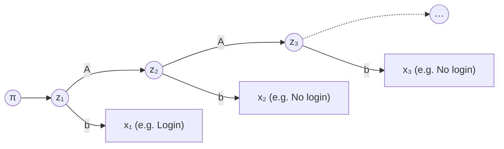

# Hidden Markov Models from Scratch: Derivations and Study Guide

This guide starts from conditional probability and derives every core algorithm of the Hidden Markov Model (HMM) step by step. A single toy example, a player who is either **Active** or **Cold**, runs through every chapter and is checked by hand. All you need is matrix multiplication and the definition of conditional probability.

Read the chapters in order. Each derivation only uses results from earlier chapters, so if you get stuck, the justification is usually one chapter back.

**Files in this folder**

| File | Contents |
| --- | --- |
| `README.md` | This guide |
| `hmm.py` | From-scratch NumPy implementation (forward, backward, Viterbi, Baum-Welch, sampling) |
| `test_hmm.py` | Tests that check the code against every hand-computed number in this guide |

Run the tests from the repo root with `pytest math-models/hidden-markov-models`.

## Contents

1. [Probability foundations](#chapter-1-probability-foundations-the-five-tools-hmms-use)
2. [Markov chains: starting from random walks](#chapter-2-markov-chains-starting-from-random-walks)
3. [The HMM: a random walk you cannot see](#chapter-3-the-hmm-a-random-walk-you-cannot-see)
4. [The forward algorithm](#chapter-4-the-forward-algorithm-turning-an-exponential-sum-into-a-recursion)
5. [The backward algorithm and state posteriors](#chapter-5-the-backward-algorithm-and-state-posteriors)
6. [The Viterbi algorithm](#chapter-6-the-viterbi-algorithm-finding-the-most-likely-path)
7. [The Baum-Welch algorithm](#chapter-7-the-baum-welch-algorithm-estimating-parameters-when-states-are-hidden)
8. [Filtering, smoothing, prediction, decoding](#chapter-8-filtering-smoothing-prediction-decoding-dont-mix-them-up)
9. [Exercises and implementation](#chapter-9-exercises-and-implementation)
10. [How HMMs relate to other models](#chapter-10-how-hmms-relate-to-other-models)
11. [Further reading and a four-week study plan](#further-reading-and-a-four-week-study-plan)

## Notation

| Symbol | Meaning |
| --- | --- |
| N | Number of hidden states |
| T | Sequence length (number of time steps) |
| z_t | Hidden state at step t, taking values 1, …, N |
| x_t | Observation at step t |
| x_{1:t} | Observations from step 1 to step t: x_1, x_2, …, x_t |
| π_i | Initial state distribution: P(z_1 = i) |
| A_ij | Transition probability: P(z_t = j \| z_{t−1} = i) |
| b_j(x) | Emission probability: P(x_t = x \| z_t = j) |
| λ | All parameters together, (π, A, B) |
| α, β, γ, ξ, δ | Intermediate quantities, defined in Chapters 4–7 |

## Chapter 1. Probability foundations: the five tools HMMs use

Every HMM derivation uses only five probability tools: the definition of conditional probability, the chain rule, the law of total probability, Bayes' theorem, and conditional independence. All of them build on the joint probability in Section 1.0. Every later derivation step names the tool it uses.

### 1.0 Starting point: joint and marginal probability

The **joint probability** P(A, B) is the probability that A and B happen together; read the comma as "and". For random variables, listing the joint probability of every combination of values gives the **joint distribution**, a table whose cells sum to 1.

Using the running example: a player's state today z (Active / Cold) and whether they logged in today x. With the parameters from Chapter 3, the joint distribution is:

| | Login | No login | Row total |
| --- | --- | --- | --- |
| Active | 0.54 | 0.06 | 0.60 |
| Cold | 0.12 | 0.28 | 0.40 |
| Column total | 0.66 | 0.34 | 1.00 |

Each cell is a joint probability. For example P(Active, Login) = 0.54: pick a random player-day, and there is a 54% chance the player was Active *and* logged in.

The **marginal probability** is the probability of one variable while ignoring the other. You get it by summing over all values of the other variable: P(Login) = 0.54 + 0.12 = 0.66 and P(Active) = 0.54 + 0.06 = 0.60. These totals are written in the table's margins, which is where the name comes from. This "sum out a variable" operation is called **marginalization**, and it is exactly the law of total probability in Section 1.3.

**The joint distribution contains all the information about the two variables.** Everything else can be derived from it:

- Marginals: sum along a row or column, as above.
- Conditionals: fix the row or column of the condition, then divide by its total. P(Login | Active) = 0.54 / 0.60 = 0.9 and P(Active | Login) = 0.54 / 0.66 ≈ 0.818. This is the definition in Section 1.1.
- Independence: the variables are independent if and only if every cell equals its row total times its column total. Here P(Active) × P(Login) = 0.60 × 0.66 = 0.396 ≠ 0.54, so state and login are not independent.

With more variables, the number of cells grows exponentially. Three days of z_1, z_2, z_3 and x_1, x_2, x_3 are six binary variables, so the joint table has 2^6 = 64 cells; 30 days would need 2^60 cells. That is why an HMM never stores this table. Instead it uses the chain rule plus two assumptions to write the joint probability as a product of a few parameters (Section 3.4). For continuous observations the joint probability becomes a **joint density** and sums become integrals; the logic is unchanged.

### 1.1 Conditional probability

The definition of conditional probability is:

```math
P(A \mid B) = \frac{P(A, B)}{P(B)}
```

Intuitively, it restricts the world to the cases where B has happened, then asks what fraction of those cases also have A. For example, if 200 of 1,000 players are payers and 150 of those payers logged in this week, then P(Login | Payer) = 150 / 200 = 0.75.

### 1.2 The chain rule

Rearranging the definition gives P(A, B) = P(A) · P(B | A). Applying it repeatedly, any joint probability can be split into a product of conditional probabilities:

```math
P(A_1, A_2, \dots, A_n) = P(A_1)\, P(A_2 \mid A_1)\, P(A_3 \mid A_1, A_2) \cdots P(A_n \mid A_1, \dots, A_{n-1})
```

This formula always holds and needs no assumptions. The problem is that the conditions in the later terms keep growing, and those terms are impossible to estimate. What an HMM does is use two assumptions to cut those long conditions short (Chapter 3).

### 1.3 The law of total probability (marginalization)

If the values of B are mutually exclusive and exhaustive, then:

```math
P(A) = \sum_{i} P(A, B = i) = \sum_{i} P(B = i)\, P(A \mid B = i)
```

Its use: **for a variable you cannot see, or do not care about, add up over all its possible values to "sum it out".** In an HMM the states are hidden, so almost every algorithm sums over hidden states using this formula.

It also has a matrix view. Put P(B = i) in a row vector p and P(A = j | B = i) in a matrix M (row i, column j). Then the row vector of all P(A = j) is p · M. The transition matrix in Chapter 2 is used exactly this way.

### 1.4 Bayes' theorem

Using the definition of conditional probability twice gives:

```math
P(B \mid A) = \frac{P(A \mid B)\, P(B)}{P(A)} = \frac{P(A \mid B)\, P(B)}{\sum_{i} P(A \mid B = i)\, P(B = i)}
```

Read it as "posterior = likelihood × prior ÷ evidence". The denominator is the law of total probability. It only normalizes, making the posterior sum to 1.

An example that comes back repeatedly: an Active player logs in on a given day with probability 0.9, a Cold player with probability 0.3, and before seeing any data we believe there is a 60% chance the player is Active. Today we see a login. The posterior probability that the player is Active is:

```math
P(\text{Active} \mid \text{Login}) = \frac{0.9 \times 0.6}{0.9 \times 0.6 + 0.3 \times 0.4} = \frac{0.54}{0.66} \approx 0.818
```

**This is the core move of an HMM: infer the hidden state from the visible observation.** The forward algorithm in Chapter 4 simply repeats this calculation day after day.

### 1.5 Conditional independence

A and B are conditionally independent given C when:

```math
P(A, B \mid C) = P(A \mid C)\, P(B \mid C) \quad \Longleftrightarrow \quad P(A \mid B, C) = P(A \mid C)
```

The right-hand form is more intuitive: **once you know C, also knowing B does not change your belief about A.** Whatever B could tell you about A is already contained in C.

Conditional independence is not the same as independence. For example, "high bet amount today" and "long play time today" are strongly correlated overall, because both are driven by how active the player is. But given that the player is in a particular activity stage, the two may be (approximately) uncorrelated. Both core HMM assumptions are conditional independence statements.

**Side note: correlation versus independence.** Independence is a requirement on the whole distribution: P(X, Y) = P(X) P(Y) for every value, so knowing X does not change anything about the distribution of Y. The correlation coefficient only measures the strength of a *linear* relationship:

```math
\rho = \frac{\mathrm{Cov}(X, Y)}{\sigma_X\, \sigma_Y}, \qquad \mathrm{Cov}(X, Y) = E[XY] - E[X]\,E[Y]
```

The relationship runs one way:

- **Independent ⇒ uncorrelated.** Independence gives E[XY] = E[X] E[Y], so the covariance is 0 and the correlation is exactly 0, not merely "low". Equivalently, a nonzero correlation means the variables are *not* independent.
- **Uncorrelated ⇏ independent.** If X is uniform on [−1, 1] and Y = X², then Y is fully determined by X, yet by symmetry Cov(X, Y) = E[X³] = 0. Zero correlation only rules out a linear relationship.
- **The size of the correlation is not the strength of dependence.** In the example above the dependence is total, yet the correlation is 0. General dependence is measured by quantities such as mutual information. Also, a correlation computed from a finite sample fluctuates around 0 even when the variables are independent.

Back to bet amount and play time: they are correlated overall, so they are not independent. But within each activity stage they may just fluctuate around that stage's mean, unrelated to each other. Pool all the days together, and long-play days come mostly from the high-activity stage, which is also where bets are high, so a correlation appears. This is correlation from a **common cause**: **"dependent overall" and "conditionally independent given the state" can both be true at once.**

### 1.6 Where the five tools appear in an HMM

| Tool | Where it is used in an HMM |
| --- | --- |
| Definition of conditional probability | Every model parameter (transition and emission probabilities) is a conditional probability |
| Chain rule | Writing the joint probability of states and observations (Chapter 3) |
| Law of total probability | Summing over hidden states: the forward and backward algorithms, and propagating distributions forward (Chapters 2, 4, 5, 8) |
| Bayes' theorem | Inferring states from observations: filtering and smoothing (Chapters 4, 5) |
| Conditional independence | The two model assumptions that make the joint probability factorize and the algorithms recursive (Chapter 3 onward) |

## Chapter 2. Markov chains: starting from random walks

A Markov chain is a random process where "where you go next depends only on where you are now". The random walk is its most intuitive example, and the hidden layer of an HMM is exactly a Markov chain.

### 2.1 Random walks

The simplest random walk: a person stands at 0 on the number line. At each step they flip a coin and move one unit right on heads and one unit left on tails. Let S_t be the position after t steps.

The key observation: to predict the next position, you only need the current position. How they got here (how many loops they made before) does not matter at all:

```math
P(S_{t+1} \mid S_t, S_{t-1}, \dots, S_0) = P(S_{t+1} \mid S_t)
```

This is the **Markov property**, often described as "memorylessness": the present contains all the history needed to predict the future.

Random walks come in many variants, all relevant later:

- **Random walk on a graph**: on a network, each step moves from the current node to a uniformly random neighbor. Replace "nodes" with "player states" and you have a player wandering between behavioral stages.
- **Gambler's ruin**: the position is a gambler's bankroll; once it hits 0 (broke), it stops forever. Such a position is an **absorbing state**. Mathematically it has the same structure as "player churn".

### 2.2 Definition of a Markov chain

Generalizing the random walk: a sequence of random variables z_1, z_2, … jumps between a finite set of states {1, …, N} and satisfies the Markov property:

```math
P(z_t \mid z_{t-1}, z_{t-2}, \dots, z_1) = P(z_t \mid z_{t-1})
```

If these transition probabilities do not change with t, the chain is **time-homogeneous**. HMMs are homogeneous by default.

### 2.3 The transition matrix

A homogeneous chain's transition rule can be written as an N × N matrix A with A_ij = P(z_t = j | z_{t−1} = i). Row i is "the probabilities of going to each state next, starting from state i". Since the chain must go somewhere, **every row sums to 1**. Such a matrix is called a **stochastic matrix**.

The running example: a player has two states, Active (state 1) and Cold (state 2):

```math
A = \begin{pmatrix} 0.8 & 0.2 \\ 0.3 & 0.7 \end{pmatrix}
```

Row 1 reads: an Active player today stays Active tomorrow with probability 80% and turns Cold with probability 20%. Row 2 reads: a Cold player today returns to Active tomorrow with probability 30% and stays Cold with probability 70%.

### 2.4 How a distribution evolves over time

Suppose we do not know today's state for sure, only a distribution p_t = (P(z_t = 1), P(z_t = 2)). What is tomorrow's distribution? Apply the law of total probability, summing over today's state:

```math
P(z_{t+1} = j) = \sum_{i} P(z_t = i)\, P(z_{t+1} = j \mid z_t = i) = \sum_{i} p_t(i)\, A_{ij}
```

In matrix form it is one line:

```math
p_{t+1} = p_t\, A
```

This is a direct application of the matrix view in Section 1.3. For example, if today p_t = (0.5, 0.5), then tomorrow P(Active) = 0.5 × 0.8 + 0.5 × 0.3 = 0.55 and P(Cold) = 0.45.

### 2.5 n-step transitions: powers of the matrix

Starting from state i, what is the probability of being in j two steps later? The middle step could pass through any state k, so use total probability again:

```math
P(z_{t+2} = j \mid z_t = i) = \sum_{k} A_{ik}\, A_{kj} = (A^2)_{ij}
```

The sum is exactly the definition of matrix multiplication. By induction, n-step transition probabilities are the entries of A^n. In our example:

```math
A^2 = \begin{pmatrix} 0.70 & 0.30 \\ 0.45 & 0.55 \end{pmatrix}
```

So a player who is Active today is still Active the day after tomorrow with probability 0.70. This identity is the **Chapman-Kolmogorov equation**. Chapter 8 uses A^k for "k days ahead" predictions.

### 2.6 The stationary distribution

If a distribution π satisfies π = π A, then a chain started from π never changes its distribution. This π is the **stationary distribution**. In linear algebra terms it is the (normalized) left eigenvector of A with eigenvalue 1.

For our example: flow out of Active must equal flow in, so 0.2 · π_1 = 0.3 · π_2, and with π_1 + π_2 = 1 we get π = (0.6, 0.4). Meaning: in the long run, a player spends 60% of days Active.

For a chain where every state can reach every other and there is no fixed period, every row of A^n converges to π regardless of the starting state. How fast it converges is set by the second-largest eigenvalue of A (used in Chapter 8).

### 2.7 How long a state lasts

Once a player becomes Active, how many days do they stay? Each day they stay with probability a = A_11 and leave with probability 1 − a, so the probability of staying exactly k days is a^(k−1) · (1 − a). This is a **geometric distribution**, with mean:

```math
E[\text{days in state}] = \sum_{k=1}^{\infty} k\, a^{k-1}(1-a) = \frac{1}{1-a}
```

In our example the Active state lasts 1 / 0.2 = 5 days on average and the Cold state 1 / 0.3 ≈ 3.3 days. This also exposes a hidden assumption of the HMM: **state durations are always geometric**, so the single most likely duration is always 1 day. If stage durations in your domain clearly do not look like this, use a **hidden semi-Markov model (HSMM)**.

### 2.8 Absorbing states and hitting times

A state that can never be left once entered (for example "permanently churned") is an absorbing state; its diagonal entry in A is 1. Let Q be the transition submatrix among the non-absorbing states. The expected number of steps until absorption, from each non-absorbing state, is:

```math
t = (I - Q)^{-1} \mathbf{1}
```

Here **1** is a column vector of ones and (I − Q)^(−1) is the **fundamental matrix**. Derivation: the expected steps from i equal 1 + Σ_k Q_ik · (expected steps from k), which in matrix form is t = 1 + Q t; solve for t. "How many rounds until the gambler goes broke" and "how many days until the player churns" use the same formula.

## Chapter 3. The HMM: a random walk you cannot see

An HMM is a Markov chain you cannot see that emits a visible, noisy observation at every step. Every derivation comes from the chain rule plus two conditional independence assumptions.

### 3.1 From Markov chain to HMM

In Chapter 2 we could see directly whether a player was Active or Cold today. In practice we cannot: we only see behavioral data, such as whether the player logged in today. An Active player may skip a day, and a Cold player may occasionally log in for a quick look.

So the model has two layers:

- **Hidden layer**: the state sequence z_1, z_2, …, z_T is a Markov chain, a random walk we cannot see.
- **Observation layer**: the observation sequence x_1, x_2, …, x_T. At each step the system "emits" one observation according to the **emission distribution** of its current state.

An analogy: someone walks randomly through a pitch-dark building (hidden layer). You cannot see them; you can only hear a little sound through each room's microphone (observation layer). The sounds are related to the rooms but do not map one-to-one, and you must infer the route from them.



The circles are hidden states and the boxes are observations. Horizontal arrows are the transition matrix A; vertical arrows are the emission distribution b. There are no arrows between observations: any correlation between them has to flow through the state chain above.

### 3.2 Model parameters

An HMM is fully specified by three groups of parameters, λ = (π, A, B):

- Initial distribution π: π_i = P(z_1 = i).
- **Transition matrix** A: A_ij = P(z_t = j | z_{t−1} = i), exactly as in Chapter 2.
- Emission distribution B: b_j(x) = P(x_t = x | z_t = j). For discrete observations B is an N × K matrix, where K is the number of possible observation values, and each row sums to 1.

The full parameters for the running example follow. The transition matrix is from Chapter 2. The initial distribution is π = (0.6, 0.4), which happens to be the stationary distribution. The observation is "logged in today or not":

| State | P(Login) | P(No login) |
| --- | --- | --- |
| 1 Active | 0.9 | 0.1 |
| 2 Cold | 0.3 | 0.7 |

The observation sequence used throughout this guide is three days: **Login, No login, No login**.

### 3.3 The two core assumptions

**Assumption 1 (homogeneous Markov assumption)**: today's state depends only on yesterday's state, not on earlier states or on any past observation:

```math
P(z_t \mid z_{1:t-1},\, x_{1:t-1}) = P(z_t \mid z_{t-1}) = A_{z_{t-1} z_t}
```

**Assumption 2 (output independence assumption)**: today's observation depends only on today's state. Once today's state is known, states and observations at other times provide no extra information:

```math
P(x_t \mid z_{1:T},\, x_{1:t-1},\, x_{t+1:T}) = P(x_t \mid z_t) = b_{z_t}(x_t)
```

Both are conditional independence statements (Section 1.5). Assumption 2 implies that **all correlation over time must flow through the hidden states**. Yesterday's observation helps predict today only because it tells us about yesterday's state, and yesterday's state influences today's state.

### 3.4 Deriving the joint probability

Take a specific state path z_{1:T} and observation sequence x_{1:T}, and ask for the probability that they occur together, i.e. their **joint probability** (Section 1.0). Apply the chain rule (Section 1.2) in time order z_1, x_1, z_2, x_2, …; this step needs no assumptions:

```math
P(x_{1:T}, z_{1:T}) = P(z_1)\, P(x_1 \mid z_1) \prod_{t=2}^{T} P(z_t \mid z_{1:t-1}, x_{1:t-1})\; P(x_t \mid z_{1:t}, x_{1:t-1})
```

Now simplify the first conditional with Assumption 1 and the second with Assumption 2. All the long conditions collapse:

```math
P(x_{1:T}, z_{1:T}) = \pi_{z_1}\, b_{z_1}(x_1) \prod_{t=2}^{T} A_{z_{t-1} z_t}\, b_{z_t}(x_t)
```

This is the single most important formula of the HMM; every algorithm starts from it. It reads directly: walk along the path and multiply the starting probability, every transition probability, and every emission probability.

A hand calculation for one path: states Active, Cold, Cold with observations Login, No login, No login:

```math
P = \underbrace{0.6}_{\pi_1} \times \underbrace{0.9}_{b_1(\text{Login})} \times \underbrace{0.2}_{A_{12}} \times \underbrace{0.7}_{b_2(\text{No})} \times \underbrace{0.7}_{A_{22}} \times \underbrace{0.7}_{b_2(\text{No})} = 0.037044
```

### 3.5 Probability of the observations: why we need algorithms

In practice the state path is hidden and we care about the probability of the observations alone, P(x_{1:T}). By the law of total probability, sum over all possible state paths:

```math
P(x_{1:T}) = \sum_{z_1=1}^{N} \sum_{z_2=1}^{N} \cdots \sum_{z_T=1}^{N} P(x_{1:T}, z_{1:T})
```

The problem is that there are N^T paths. Our example with N = 2 and T = 3 has only 8, easy by hand. But with N = 5 and T = 30 there are about 9.3 × 10^20 paths, far too many to enumerate. The forward algorithm in Chapter 4 brings this down to the order of N² × T = 750 multiplications.

### 3.6 The four basic HMM problems

| Problem | Question answered | Algorithm | Chapter |
| --- | --- | --- | --- |
| Evaluation | Given the parameters, how likely is the observation sequence, P(x_{1:T})? | Forward algorithm | 4 |
| Inference | Probability of each state at each time step | Forward (filtering), forward-backward (smoothing) | 4, 5, 8 |
| Decoding | The single most likely full state path | Viterbi | 6 |
| Learning | Given only observations, estimate π, A, B | Baum-Welch (EM) | 7 |

## Chapter 4. The forward algorithm: turning an exponential sum into a recursion

The forward algorithm exploits the fact that different paths share prefixes, reducing the N^T-term sum to about N² × T operations. For our example it gives P(Login, No login, No login) = 0.080184.

### 4.1 The core idea

Of the 8 paths, 2 share the first two steps "Active → Cold", so brute-force summation computes that prefix's probability twice. In general, every prefix of length t is shared by N^(T−t) paths, so the waste grows with sequence length. The forward algorithm instead merges, at each time step, "all paths that reach state j" into a single number, and continues from that number.

### 4.2 The forward variable

```math
\alpha_t(j) = P(x_{1:t},\; z_t = j)
```

The **forward variable** is the joint probability of seeing the first t observations *and* being in state j at step t. It has already summed out which path was taken before step t.

### 4.3 Deriving the recursion

Initialization follows from the definition and the chain rule: α_1(j) = P(z_1 = j) · P(x_1 | z_1 = j) = π_j · b_j(x_1).

The recursion is the key. Assume all α_{t−1}(i) are known and compute α_t(j):

```math
\begin{aligned}
\alpha_t(j) &= P(x_{1:t},\, z_t = j) \\
&= \sum_{i=1}^{N} P(x_{1:t-1},\, z_{t-1} = i,\, z_t = j,\, x_t) && \text{total probability over yesterday's state } i \\
&= \sum_{i=1}^{N} \underbrace{P(x_{1:t-1},\, z_{t-1} = i)}_{\alpha_{t-1}(i)} \cdot P(z_t = j \mid x_{1:t-1},\, z_{t-1} = i) \cdot P(x_t \mid x_{1:t-1},\, z_{t-1} = i,\, z_t = j) && \text{chain rule} \\
&= \sum_{i=1}^{N} \alpha_{t-1}(i) \cdot A_{ij} \cdot b_j(x_t) && \text{Assumptions 1 and 2} \\
&= \Big[ \sum_{i=1}^{N} \alpha_{t-1}(i)\, A_{ij} \Big] \cdot b_j(x_t)
\end{aligned}
```

Finally, P(x_{1:T}) sums over the last state:

```math
P(x_{1:T}) = \sum_{j=1}^{N} \alpha_T(j)
```

### 4.4 Matrix form and intuition: predict, then update

Treat α_t as a row vector, b(x_t) as the vector of emission probabilities across states, and ⊙ as element-wise multiplication:

```math
\alpha_t = (\alpha_{t-1}\, A) \odot b(x_t)
```

Compare with p_{t+1} = p_t A from Section 2.4: **the forward algorithm is the Markov chain's distribution update plus a Bayesian correction from each observation.**

1. Predict: α_{t−1} A pushes yesterday's belief to today using the transition matrix (total probability).
2. Update: ⊙ b(x_t) multiplies in how likely today's observation is under each state (the numerator of Bayes' theorem).

Normalizing α_t gives exactly the Bayesian posterior P(z_t = j | x_{1:t}). The 0.818 in Section 1.4 is the result at t = 1. This predict-update structure is identical to the **Kalman filter** (Chapter 10).

### 4.5 Worked example

Observations: Login, No login, No login.

| t | Obs | Predicted: Active | Predicted: Cold | α_t(Active) | α_t(Cold) | Normalized: P(Active \| x_{1:t}) |
| --- | --- | --- | --- | --- | --- | --- |
| 1 | Login | π = 0.6 | π = 0.4 | 0.6 × 0.9 = 0.54 | 0.4 × 0.3 = 0.12 | 0.818 |
| 2 | No login | 0.54×0.8 + 0.12×0.3 = 0.468 | 0.54×0.2 + 0.12×0.7 = 0.192 | 0.468 × 0.1 = 0.0468 | 0.192 × 0.7 = 0.1344 | 0.258 |
| 3 | No login | 0.0468×0.8 + 0.1344×0.3 = 0.07776 | 0.0468×0.2 + 0.1344×0.7 = 0.10344 | 0.07776 × 0.1 = 0.007776 | 0.10344 × 0.7 = 0.072408 | 0.097 |

So P(x_{1:3}) = 0.007776 + 0.072408 = 0.080184. The last column shows that after two days without a login, the model's belief in "Active" drops from 82% to 10%.

Exercise 3 in Chapter 9 asks you to verify a result like this by brute-force enumeration.

### 4.6 Complexity

At each time step, each state j sums over N values of i, so one step costs N² multiply-adds and the whole pass about N² × T. Compared with N^T × T for brute force, the cost drops from exponential to linear in T. This is the classic effect of **dynamic programming**: **solve each repeated subproblem only once.**

### 4.7 Numerical underflow and scaling

α_t is a product of many numbers below 1. Once T reaches a few hundred it falls below the smallest representable float and becomes 0 (**underflow**). The standard fix is to normalize at every step (**scaling**):

```math
c_t = \sum_{j} \big[(\hat\alpha_{t-1}\, A) \odot b(x_t)\big]_j, \qquad \hat\alpha_t = \frac{(\hat\alpha_{t-1}\, A) \odot b(x_t)}{c_t}
```

One can show that c_t = P(x_t | x_{1:t−1}), the predicted probability of today's observation given the past. Therefore:

```math
\log P(x_{1:T}) = \sum_{t=1}^{T} \log c_t, \qquad \hat\alpha_t(j) = P(z_t = j \mid x_{1:t})
```

The second identity is very important: **the scaled forward variable is the filtering result**, the best estimate of the current state using only data up to today. Chapter 8 explains why it is the only state probability that can be used directly for real-time prediction.

## Chapter 5. The backward algorithm and state posteriors

The backward variable summarizes what the *future* observations say. Multiplied by the forward variable, it gives the posterior γ, which uses the whole sequence to judge the state at each step. In our example, the probability of "Active" on day 1 is 0.818 when looking only at that day, but drops to 0.609 after seeing all three days.

### 5.1 The backward variable: definition and derivation

```math
\beta_t(i) = P(x_{t+1:T} \mid z_t = i)
```

The **backward variable** is the probability of all later observations given that step t is in state i. Note that it is a conditional probability, conditioned on the current state.

The recursion runs from the end backward. Given all β_{t+1}(j), compute β_t(i):

```math
\begin{aligned}
\beta_t(i) &= \sum_{j=1}^{N} P(x_{t+1:T},\, z_{t+1} = j \mid z_t = i) && \text{total probability over tomorrow's state } j \\
&= \sum_{j=1}^{N} P(z_{t+1} = j \mid z_t = i)\; P(x_{t+1} \mid z_{t+1} = j)\; P(x_{t+2:T} \mid z_{t+1} = j) && \text{chain rule + both assumptions} \\
&= \sum_{j=1}^{N} A_{ij}\; b_j(x_{t+1})\; \beta_{t+1}(j)
\end{aligned}
```

The end condition is β_T(i) = 1: there are no observations after step T, and an "empty future" happens with probability 1. In matrix form β_t = A (b(x_{t+1}) ⊙ β_{t+1}), with β as a column vector.

### 5.2 Backward variables by hand

| t | β_t(Active) | β_t(Cold) |
| --- | --- | --- |
| 3 | 1 | 1 |
| 2 | 0.8×0.1×1 + 0.2×0.7×1 = 0.22 | 0.3×0.1×1 + 0.7×0.7×1 = 0.52 |
| 1 | 0.8×0.1×0.22 + 0.2×0.7×0.52 = 0.0904 | 0.3×0.1×0.22 + 0.7×0.7×0.52 = 0.2614 |

Check: the backward variables also give the sequence probability, P(x_{1:T}) = Σ_j π_j b_j(x_1) β_1(j) = 0.54 × 0.0904 + 0.12 × 0.2614 = 0.080184, matching Chapter 4.

### 5.3 Deriving the state posterior γ

We want γ_t(j) = P(z_t = j | x_{1:T}), the **posterior marginal**: having seen the whole sequence, the probability that step t is in state j. First compute the joint probability, splitting the observations into "past + present" and "future":

```math
\begin{aligned}
P(z_t = j,\, x_{1:T}) &= P(x_{1:t},\, z_t = j) \cdot P(x_{t+1:T} \mid z_t = j,\, x_{1:t}) && \text{chain rule} \\
&= P(x_{1:t},\, z_t = j) \cdot P(x_{t+1:T} \mid z_t = j) && \text{given } z_t \text{, future is independent of past} \\
&= \alpha_t(j)\, \beta_t(j)
\end{aligned}
```

The second line is the key: **the current state separates the past from the future.** This is the Markov property at work. Then apply the definition of conditional probability (Bayes' theorem):

```math
\gamma_t(j) = \frac{\alpha_t(j)\, \beta_t(j)}{P(x_{1:T})} = \frac{\alpha_t(j)\, \beta_t(j)}{\sum_{k} \alpha_t(k)\, \beta_t(k)}
```

As a by-product we get a check: for every t, Σ_j α_t(j) β_t(j) equals P(x_{1:T}).

### 5.4 γ by hand, compared with filtering

| t | α_t β_t (Active) | α_t β_t (Cold) | Smoothed γ_t(Active) | Filtered P(Active \| x_{1:t}) |
| --- | --- | --- | --- | --- |
| 1 | 0.54 × 0.0904 = 0.048816 | 0.12 × 0.2614 = 0.031368 | 0.609 | 0.818 |
| 2 | 0.0468 × 0.22 = 0.010296 | 0.1344 × 0.52 = 0.069888 | 0.128 | 0.258 |
| 3 | 0.007776 × 1 = 0.007776 | 0.072408 × 1 = 0.072408 | 0.097 | 0.097 |

In every row the first two columns (α_t β_t) sum to 0.080184, so the check passes.

Compare the last two columns. Looking only at day 1's login, P(Active) is 0.818. But knowing that days 2 and 3 had no logins, looking back, the probability that day 1 was Active falls to 0.609. Why: Active players usually stay Active (A_11 = 0.8), so two days without a login make "the player was already turning Cold on day 1" a more plausible explanation.

**Smoothing uses information from the future.** The last day has no future, so smoothing and filtering agree there. This distinction becomes crucial in Chapter 8.

### 5.5 The pairwise posterior ξ

The learning algorithm (Chapter 7) also needs the probability that step t is in i *and* step t+1 is in j. Split the sequence into three parts:

```math
\xi_t(i, j) = P(z_t = i,\, z_{t+1} = j \mid x_{1:T}) = \frac{\overbrace{\alpha_t(i)}^{\text{reach } i} \cdot \overbrace{A_{ij}}^{i \to j} \cdot \overbrace{b_j(x_{t+1})}^{\text{emit } x_{t+1}} \cdot \overbrace{\beta_{t+1}(j)}^{\text{later observations}}}{P(x_{1:T})}
```

The derivation is the same as for γ: expand with the chain rule, then simplify with the two assumptions. The four factors correspond to "past, transition, current emission, future".

For example, the posterior probability of Active on day 1 and Cold on day 2 is ξ_1(Active, Cold) = 0.54 × 0.2 × 0.7 × 0.52 / 0.080184 ≈ 0.490.

The relation between ξ and γ: summing over j removes step t+1, so Σ_j ξ_t(i, j) = γ_t(i).

## Chapter 6. The Viterbi algorithm: finding the most likely path

The Viterbi algorithm replaces the "sum" in the forward algorithm with a "max" and records where each maximum came from, giving the globally most likely state path. In our example the answer is Active → Cold → Cold, with posterior probability 46.2%.

### 6.1 The problem

We want:

```math
z^{*}_{1:T} = \arg\max_{z_{1:T}} P(z_{1:T} \mid x_{1:T}) = \arg\max_{z_{1:T}} P(x_{1:T},\, z_{1:T})
```

The second equality holds because P(z | x) = P(x, z) / P(x), and the denominator does not depend on the path, so it does not change which path is largest. We only need to maximize the joint probability from Section 3.4.

### 6.2 Deriving the recursion

Define δ_t(j) as the probability of the single most likely path among all paths that end in state j at step t:

```math
\delta_t(j) = \max_{z_{1:t-1}} P(z_{1:t-1},\, z_t = j,\, x_{1:t})
```

The recursion is nearly identical to the forward algorithm, with Σ replaced by max:

```math
\delta_1(j) = \pi_j\, b_j(x_1), \qquad \delta_t(j) = \Big[ \max_{i} \delta_{t-1}(i)\, A_{ij} \Big] \cdot b_j(x_t)
```

Why does this work? Because of **optimal substructure**: if the best path to (t, j) passes through state i at step t−1, then its first part must be the best path to (t−1, i). Otherwise, swapping in a better first part would give a better full path, a contradiction. Mathematically, the joint probability is a product of non-negative factors, so the max can be pushed inside layer by layer, just as the sum can.

At each step we also record which i achieved the maximum, the **backpointer**:

```math
\psi_t(j) = \arg\max_{i}\; \delta_{t-1}(i)\, A_{ij}
```

At the last step, take the state with the largest δ_T as the end point, then follow the backpointers backward to recover the whole path:

```math
z^{*}_T = \arg\max_{j}\, \delta_T(j), \qquad z^{*}_{t-1} = \psi_t\big(z^{*}_t\big)
```

### 6.3 Worked example

| t | Obs | δ_t(Active) | From | δ_t(Cold) | From |
| --- | --- | --- | --- | --- | --- |
| 1 | Login | 0.6 × 0.9 = 0.54 | — | 0.4 × 0.3 = 0.12 | — |
| 2 | No login | max(0.54×0.8, 0.12×0.3) × 0.1 = 0.0432 | Active | max(0.54×0.2, 0.12×0.7) × 0.7 = 0.0756 | Active |
| 3 | No login | max(0.0432×0.8, 0.0756×0.3) × 0.1 = 0.003456 | Active | max(0.0432×0.2, 0.0756×0.7) × 0.7 = 0.037044 | Cold |

Backtracking: at step 3 the largest δ is Cold (0.037044); it came from Cold at step 2; Cold at step 2 came from Active at step 1. So the best path is **Active → Cold → Cold**.

Check: 0.037044 is exactly the joint probability of the path computed in Section 3.4. Dividing by P(x) = 0.080184 gives a posterior probability of 46.2% for this path. So even the most likely path accounts for less than half the probability. Viterbi gives a "best guess", not a certain answer.

### 6.4 Why not just take the argmax of γ at each step?

Chapter 5 already computed γ at each step. Taking the per-step maximum also gives Active, Cold, Cold. The two methods agree here, but in general they can differ:

- γ answers "looking at step t alone, where is the state most likely to be"; Viterbi answers "which full path, taken as a whole, is most likely".
- Stitching together per-step maxima can produce a jump with transition probability 0, i.e. a path that can never happen. Viterbi never does this.

In practice, γ is suited to "the probability of each stage on each day", while Viterbi is suited to "one definite sequence of stage labels" for profiling and visualization.

### 6.5 Implementation: work in log space

δ is also a product and also underflows. Since log is monotonically increasing, the location of the maximum is unchanged, so Viterbi is usually run directly in log space, where products become sums:

```math
\log \delta_t(j) = \max_{i} \big[ \log \delta_{t-1}(i) + \log A_{ij} \big] + \log b_j(x_t)
```

This is simpler than the forward algorithm's scaling, because max involves no sums and needs no logsumexp.

## Chapter 7. The Baum-Welch algorithm: estimating parameters when states are hidden

If the states were visible, estimating parameters would just be counting frequencies. When the states are hidden, replace the true counts with the "expected counts" given by γ and ξ, and iterate. That is the Baum-Welch algorithm, the special case of the **EM (expectation-maximization)** algorithm for HMMs.

### 7.1 When states are visible: maximum likelihood is counting

Suppose we have a fully labeled sequence where the true state of every day is known. Let n_ij be the number of transitions from i to j and n_i = Σ_j n_ij the total number of transitions out of i. From Section 3.4, the part of the log joint probability that involves A is:

```math
\log L(A) = \sum_{t=2}^{T} \log A_{z_{t-1} z_t} = \sum_{i,j} n_{ij} \log A_{ij}
```

We maximize it subject to "each row sums to 1". Using **Lagrange multipliers**, for row i:

```math
\mathcal{L} = \sum_{j} n_{ij} \log A_{ij} + \mu_i \Big(1 - \sum_{j} A_{ij}\Big), \qquad \frac{\partial \mathcal{L}}{\partial A_{ij}} = \frac{n_{ij}}{A_{ij}} - \mu_i = 0 \;\Rightarrow\; A_{ij} = \frac{n_{ij}}{\mu_i}
```

Substituting into the constraint Σ_j A_ij = 1 gives μ_i = n_i, so:

```math
A_{ij} = \frac{n_{ij}}{n_i} = \frac{\text{number of transitions from } i \text{ to } j}{\text{number of transitions out of } i}
```

The conclusion is very simple: **maximum likelihood estimation is counting frequencies.** Emissions work the same way: b_j(k) = (times observation k was seen in state j) ÷ (times in state j).

### 7.2 When states are hidden: use expected counts

The problem is that n_ij cannot be counted, because the states are hidden. Baum-Welch's idea: use the current parameters to compute the posterior probability of each state on each day, then replace "counts" with "expected counts".

"Step t goes from i to j" is a 0/1 event, and its expectation is its probability ξ_t(i, j). By linearity of expectation, the expected total count is the sum of the per-step expectations:

```math
E[n_{ij}] = \sum_{t=1}^{T-1} \xi_t(i, j), \qquad E[n_i] = \sum_{t=1}^{T-1} \gamma_t(i)
```

Plugging these into the formulas of 7.1 gives the Baum-Welch update rules:

```math
\begin{aligned}
\pi_i^{\text{new}} &= \gamma_1(i) \\
A_{ij}^{\text{new}} &= \frac{\sum_{t=1}^{T-1} \xi_t(i, j)}{\sum_{t=1}^{T-1} \gamma_t(i)} \\
b_j^{\text{new}}(k) &= \frac{\sum_{t=1}^{T} \gamma_t(j)\, \mathbb{1}[x_t = k]}{\sum_{t=1}^{T} \gamma_t(j)}
\end{aligned}
```

Here 1[x_t = k] is the **indicator function**: 1 when x_t = k, otherwise 0.

The full algorithm alternates two steps:

1. **E-step**: run the forward and backward algorithms with the current parameters to get all γ_t(j) and ξ_t(i, j).
2. **M-step**: update π, A, B with the formulas above.
3. Repeat until the improvement in log-likelihood log P(x_{1:T}) falls below a threshold.

There is a chicken-and-egg loop here: computing posteriors needs parameters, and estimating parameters needs posteriors. EM breaks it by starting from a guess and letting the two improve each other.

### 7.3 Why this is right: the EM view

The above is the intuitive derivation. Formally, at each step EM maximizes the **expected complete-data log-likelihood**, called the Q function:

```math
Q(\lambda, \lambda^{\text{old}}) = \sum_{z_{1:T}} P(z_{1:T} \mid x_{1:T}, \lambda^{\text{old}}) \cdot \log P(x_{1:T}, z_{1:T} \mid \lambda)
```

Substituting the log of the joint probability from Section 3.4, it splits into three sums:

```math
Q = \sum_{i} \gamma_1(i) \log \pi_i \;+\; \sum_{t=1}^{T-1} \sum_{i,j} \xi_t(i,j) \log A_{ij} \;+\; \sum_{t=1}^{T} \sum_{j} \gamma_t(j) \log b_j(x_t)
```

The expectation over paths turns into γ and ξ because each term only involves the state at one or two time steps; all other states are summed out by the law of total probability. The three parts are independent, and maximizing each with the Lagrange multipliers of 7.1 gives exactly the update rules of 7.2.

EM has an important property: **the observed-data log-likelihood log P(x | λ) never decreases from one iteration to the next.** The proof uses **Jensen's inequality**; the key result is log P(x | λ) − log P(x | λ_old) ≥ Q(λ, λ_old) − Q(λ_old, λ_old). So whenever the M-step increases Q, the likelihood increases. The price: it only guarantees convergence to a **local optimum**, so in practice you run several random initializations.

### 7.4 One iteration by hand (partial)

Using the γ and ξ from Chapter 5, do one M-step on our single three-day sequence:

- Initial distribution: π_new = (γ_1(Active), γ_1(Cold)) = (0.609, 0.391).
- Emissions: P(Login | Active) = γ_1(Active) ÷ [γ_1 + γ_2 + γ_3](Active) = 0.609 ÷ (0.609 + 0.128 + 0.097) ≈ 0.730. Likewise, P(Login | Cold) ≈ 0.391 ÷ 2.166 ≈ 0.181.
- Transitions: ξ_1(Active, Cold) ≈ 0.490 and ξ_2(Active, Cold) = 0.0468 × 0.2 × 0.7 × 1 ÷ 0.080184 ≈ 0.082. So A_new(Active → Cold) = (0.490 + 0.082) ÷ (0.609 + 0.128) ≈ 0.776.

A(Active → Cold) was only 0.2, and after one update it jumps to 0.776. Because this one sequence happens to be "one login, then no logins", the model concludes that Active players turn Cold very quickly. **With a single three-day sequence, the parameters get badly skewed**; this is **overfitting** on a tiny sample. Real training uses thousands of sequences or more.

### 7.5 Practical notes

- **Multiple sequences**: add up the expected counts across all sequences, then divide. π uses the average of γ_1 across sequences.
- **Continuous observations**: with Gaussian emissions, the M-step is a weighted mean and variance with weights γ_t(j): μ_j = Σ_t γ_t(j) x_t ÷ Σ_t γ_t(j), and σ²_j likewise. The derivation is again differentiating the third part of Q.
- **Initialization**: run several random initializations and keep the one with the highest likelihood; or run k-means first and initialize the emission distributions from the cluster centers.
- **Structural zeros**: if some A_ij is initialized to 0, then ξ_t(i, j) is always 0 and the update keeps it at 0. This can be used to impose structural constraints on the model.
- **Label switching**: state indices have no intrinsic meaning; "state 1" in two training runs may be different things. Align states across runs by features such as their emission means.

## Chapter 8. Filtering, smoothing, prediction, decoding: don't mix them up

For real-time prediction, use only the filtered result α̂_t and push it forward with A^k. Smoothing (γ) and Viterbi both use future data and are only suitable for after-the-fact analysis. In our example, after three days of observations, the predicted probability of a login on day 4 is 50.9%.

### 8.1 The four computations

| Task | Question answered | Formula | Data used | Good for |
| --- | --- | --- | --- | --- |
| Filtering | Which state is the player in today? | α̂_t = P(z_t \| x_{1:t}) | Up to today | Real-time assessment, starting point for prediction |
| Prediction | Which state in k days? | α̂_t · A^k | Up to today | Churn alerts, forward planning |
| Smoothing | Looking back, which state was day t in? | γ_t = P(z_t \| x_{1:T}) | The whole sequence, including after t | Retrospective analysis, parameter learning |
| Decoding | The most likely full path | Viterbi | The whole sequence | Labeling, profiling, visualization |

### 8.2 Deriving state prediction

Given observations up to t, find the state distribution at t + 1. Sum over today's state with total probability, then apply Assumption 1 (tomorrow's state depends only on today's):

```math
P(z_{t+1} = j \mid x_{1:t}) = \sum_{i} P(z_t = i \mid x_{1:t})\; P(z_{t+1} = j \mid z_t = i) = \sum_{i} \hat\alpha_t(i)\, A_{ij}
```

That is α̂_t A; repeating k times gives α̂_t A^k. This is exactly the distribution update of Section 2.4. **The only difference is the starting point**: not a prior, but the filtered posterior corrected by observations.

To predict a future observation, sum over states once more:

```math
P(x_{t+1} = k \mid x_{1:t}) = \sum_{j} \big(\hat\alpha_t\, A\big)_j\; b_j(k)
```

This quantity is exactly the scaling factor c_{t+1} from Section 4.7.

### 8.3 Prediction by hand

The filtered result on day 3 is α̂_3 = (0.097, 0.903).

- State distribution on day 4: Active = 0.097 × 0.8 + 0.903 × 0.3 ≈ 0.348, Cold ≈ 0.652.
- Probability of a login on day 4: 0.348 × 0.9 + 0.652 × 0.3 ≈ 0.509.

### 8.4 Predictions "forget": the linear algebra view

Predicting further ahead, α̂_3 A^k gradually converges to the stationary distribution (0.6, 0.4). In other words, **the further ahead you predict, the less the observations tell you, until only the long-run average remains.**

The speed of convergence is set by the second-largest eigenvalue of A. A 2 × 2 transition matrix has eigenvalues 1 and A_11 + A_22 − 1, which here is 0.8 + 0.7 − 1 = 0.5. So the gap between the predicted and stationary distributions halves with every extra day of prediction (here t = 3):

```math
P(z_{t+k} = \text{Active} \mid x_{1:t}) - 0.6 = (0.097 - 0.6) \times 0.5^{k}
```

At k = 1, −0.503 × 0.5 ≈ −0.252, giving P(Active) = 0.348, which matches the hand calculation in 8.3. The closer the second eigenvalue is to 1, the "stickier" the states, the longer an observation's influence lasts, and the better suited the model is to long-range prediction.

### 8.5 The most common mistake: predicting with smoothed results

Recall Section 5.4: day 1's probability of Active is 0.818 filtered and 0.609 smoothed. The smoothed value is lower because it "peeked" at the fact that days 2 and 3 had no logins.

If you use smoothed posteriors (or Viterbi labels) on historical data as features to train a "will this player churn" model, those features already contain future information. Offline evaluation will look excellent, but performance drops sharply in production. This is **data leakage**.

The correct approach: for each day t, run the forward algorithm on x_{1:t} only and take α̂_t. If your library only provides smoothed posteriors (such as hmmlearn's `predict_proba`), call it on the prefix up to t and take the last row. At the last step of a sequence, the smoothed and filtered posteriors are equal (β_T = 1).

## Chapter 9. Exercises and implementation

Do the exercises first, then the code: each exercise corresponds to a derivation above, and each line of code corresponds to a formula above. The implementation in [`hmm.py`](hmm.py) has been run, and [`test_hmm.py`](test_hmm.py) checks that its output matches every hand calculation in this guide.

### 9.1 Exercises

1. **(Ch. 2)** Prove: if every row of A sums to 1, so does every row of A². Hint: with the all-ones column vector **1**, "rows sum to 1" is equivalent to A**1** = **1**.
2. **(Ch. 2)** For A = [[0.9, 0.1], [0.5, 0.5]], find the stationary distribution and the expected duration of each state. Answer: (5/6, 1/6); 10 days and 2 days.
3. **(Ch. 3, 4)** The observations are "Login, Login". Compute P(x) by brute-force enumeration of the 4 paths, then with the forward algorithm, and compare. Answer: both give 0.4788 (the four paths are 0.3888, 0.0324, 0.0324, 0.0252).
4. **(Ch. 5)** In your own words: why is day 1's smoothed probability 0.609 lower than its filtered probability 0.818? If days 2 and 3 had both been logins, would the smoothed probability be higher or lower than the filtered one?
5. **(Ch. 5)** Prove Σ_j ξ_t(i, j) = γ_t(i). Hint: sum the ξ formula over j; the sum of the last three factors is exactly the recursion for β_t(i).
6. **(Ch. 6)** Construct an example where the per-step argmax of γ yields a path containing a transition with probability 0. Hint: set A_12 = 0.
7. **(Ch. 7)** Derive the M-step for Gaussian emissions: differentiate Σ_t γ_t(j) log N(x_t; μ_j, σ²_j) with respect to μ_j and σ²_j and set the derivatives to 0.
8. **(Ch. 8)** For this guide's example, compute P(z_{3+k} = Active | x_{1:3}) for k = 1, 2, 3, and verify that the gap to the stationary distribution halves each time.

### 9.2 Implementation from scratch

[`hmm.py`](hmm.py) implements the discrete-observation version in NumPy: scaled forward, backward, log-space Viterbi, single-sequence Baum-Welch, and a sampler. Convention: `B[j, k] = P(x = k | z = j)`, and observations are encoded as 0, 1, …, K−1.

One detail worth understanding: with scaling, the scaled β multiplied by the scaled α gives γ directly, and ξ only needs an extra division by c_{t+1}. This works because the scaling factors divided out of α and β multiply together to exactly P(x).

### 9.3 Checking against the worked example

```python
import numpy as np
from hmm import forward, backward, viterbi

pi = np.array([0.6, 0.4])
A = np.array([[0.8, 0.2], [0.3, 0.7]])
B = np.array([[0.1, 0.9],      # Active: P(no login), P(login)
              [0.7, 0.3]])     # Cold
x = [1, 0, 0]                  # Login, No login, No login

alpha, c = forward(pi, A, B, x)
print(np.prod(c))              # 0.080184             (Section 4.5)
print(alpha[:, 0])             # [0.818 0.258 0.097]  (filtering)
print((alpha * backward(A, B, x, c))[:, 0])  # [0.609 0.128 0.097]  (smoothing, Section 5.4)
print(viterbi(pi, A, B, x))    # ([0, 1, 1], 0.037044) (Section 6.3)
print(alpha[-1] @ A)           # [0.348 0.652]        (Section 8.3)
```

### 9.4 Hands-on experiment: can the parameters be recovered?

Using the true parameters above, simulate 5,000 days by following the generative process of Section 3.1 (draw the initial state from π; at each step draw the observation from the matching row of B and the next state from the matching row of A). Try writing this sampler yourself before looking at `sample()` in `hmm.py`. Then run Baum-Welch from a random initialization. One actual run gave:

| Parameter | True value | Learned value |
| --- | --- | --- |
| P(Login \| Active) | 0.9 | 0.922 |
| P(Login \| Cold) | 0.3 | 0.241 |
| A(Active → Active) | 0.8 | 0.787 |
| A(Cold → Cold) | 0.7 | 0.660 |

The parameters are largely recovered. Note that the learned model labeled "Active" as state 1 and "Cold" as state 0, the reverse of the true labels: this is the label switching described in Section 7.5.

Suggested follow-up experiments:

- Change the sequence length from 5,000 to 50, repeat 20 times, and watch how much the estimates fluctuate. This is the small-sample problem of Section 7.4.
- Try different seeds and see whether the algorithm converges to different local optima.
- Fit the same data with hmmlearn's `CategoricalHMM` and compare; then extend your own code to support multiple sequences.

## Chapter 10. How HMMs relate to other models

HMMs sit at the intersection of several model families: remove the transitions and you get a mixture model; remove the "hidden" part and you get a Markov chain; replace discrete states with continuous ones and you get the Kalman filter. Knowing these relationships helps you judge when an HMM is not enough and which model to switch to.

| Model | Relationship to the HMM | When to consider it |
| --- | --- | --- |
| Markov chain | The HMM's hidden layer; if the observation *is* the state, the HMM reduces to a Markov chain | States are directly observable, e.g. rule-based player tiers |
| Mixture model (e.g. GMM) | Remove the transitions and draw each step's state independently, and the HMM reduces to a mixture model; γ becomes the cluster "responsibility" | The data has no time order and you only need clustering |
| Naive Bayes | An HMM can be seen as "sequential Naive Bayes": both are generative and assume observations are conditionally independent given the class (state) | Classifying single samples |
| Hidden semi-Markov model (HSMM) | Models each state's duration explicitly, removing the "durations are always geometric" limitation of Section 2.7 | Stage durations have a typical value, e.g. a newcomer phase of about 7 days |
| Autoregressive HMM (AR-HMM) | The emission also depends on the previous observation, relaxing "observations depend only on the current state" | Observations remain strongly autocorrelated within a state |
| Input-output HMM (IOHMM) | Transition or emission probabilities depend on external covariates | Events, releases, or acquisition channels change state transitions |
| Kalman filter | Continuous hidden state with linear-Gaussian transitions and emissions; the forward algorithm corresponds to the Kalman filter, forward-backward to RTS smoothing | The hidden variable is continuous, e.g. smoothing a "true activity level" |
| Conditional random field (CRF) | The discriminative counterpart of the HMM, as logistic regression is to Naive Bayes; models P(z \| x) directly and can use overlapping, correlated features | Labeled sequence-tagging tasks, such as word segmentation or named entity recognition |
| Recurrent neural network (RNN, LSTM) | The hidden state is a continuous vector updated by a deterministic function, not a probability distribution; very expressive, but no explicit state meaning or transition matrix | You care only about prediction accuracy, have lots of data, and do not need interpretable stages |

Two relationships worth remembering:

- **The forward algorithm and the Kalman filter are the same algorithm.** Both are predict-update recursions: push the previous belief forward with the transition model (total probability), then correct it with the current observation (Bayes' theorem). The HMM's belief is a discrete probability vector; the Kalman filter's is the mean and variance of a Gaussian. This family of methods is called **Bayesian filtering**.
- **Generative versus discriminative.** An HMM models the joint probability P(x, z), so it can generate data and learn without supervision, but it must assume a distribution for the observations. CRFs and RNNs model P(z | x) or predict directly, which is more flexible with features but usually needs labels. Player lifecycles have no ready-made stage labels, which is exactly where HMMs have the advantage.

## Further reading and a four-week study plan

This guide covers the main line of derivations. The materials below fill in background, give a second angle on the same ideas, and bridge to applications. The list is compiled from the author's knowledge; editions and links have not been individually verified, so search by title.

### Further reading

| Material | Type | Why read it | Chapters |
| --- | --- | --- | --- |
| Blitzstein & Hwang, *Introduction to Probability*, Ch. 2 and 11 | Textbook + Harvard Stat 110 lectures | The most intuitive treatment of conditional probability and Markov chains, with many examples | 1–2 |
| Li Hang, *Statistical Learning Methods* (统计学习方法), Ch. 10 | Textbook (Chinese) | Notation close to this guide; full worked derivations of all three basic problems | 3–7 |
| Jurafsky & Martin, *Speech and Language Processing*, 3rd ed., Appendix A | Textbook chapter (free draft) | Short, with clear figures; good for a second pass | 3–7 |
| Eisner (2002), *An Interactive Spreadsheet for Teaching the Forward-Backward Algorithm* | Paper + spreadsheet | The famous "ice cream" example; change parameters in the spreadsheet and watch the posteriors move | 4–5, 7 |
| Rabiner (1989), *A Tutorial on Hidden Markov Models and Selected Applications in Speech Recognition* | Classic tutorial paper | The source of nearly every HMM textbook treatment; thorough on scaling and multi-sequence training | 4–7 |
| Bishop, *Pattern Recognition and Machine Learning*, Ch. 13 | Textbook | Unified derivation from graphical models and EM; more mathematically rigorous | 7, 10 |
| Zucchini, MacDonald & Langrock, *Hidden Markov Models for Time Series*, 2nd ed. | Applied statistics monograph | Covariates, model checking (pseudo-residuals), forecasting, choosing the number of states; closest to real-world use | 8 and applications |
| Murphy, *Probabilistic Machine Learning: Advanced Topics*, state-space model chapters | Textbook | Puts HMMs, Kalman filters, and modern extensions in one framework | 10 |
| hmmlearn documentation | Library docs | From derivation to tooling; parameter names map one-to-one to this guide's π, A, B | 9 |

### Four-week study plan

Plan for about 5 hours per week. The core principle: **work every chapter's example by hand, then verify it in code.** Reading without calculating makes it hard to truly internalize how the recursions work.

| Week | This guide | Companion reading | Exercises | Deliverable for the week |
| --- | --- | --- | --- | --- |
| 1 | Intro, Ch. 1–3 | Blitzstein Ch. 2, 11 (optional) | 1, 2 | Derive the HMM joint probability from memory on paper |
| 2 | Ch. 4–6 | Li Hang Ch. 10 or Jurafsky Appendix A; Eisner spreadsheet | 3–6 | Implement forward, backward, viterbi; match every hand-computed number |
| 3 | Ch. 7–8 | Rabiner Section III; Bishop 13.2 | 7, 8 | Implement Baum-Welch; run the simulation and follow-up experiments of 9.4 |
| 4 | Ch. 10 | Zucchini et al., forecasting and model-checking chapters | — | Fit an hmmlearn model on real player data and make one forward-looking prediction from the filtered states |

How to know you are done: you can derive the forward recursion and the Baum-Welch transition update on a blank sheet of paper; you can explain why real-time prediction must not use smoothed posteriors; and you can name the situations where each of the two HMM assumptions breaks, along with the extension model to switch to.
